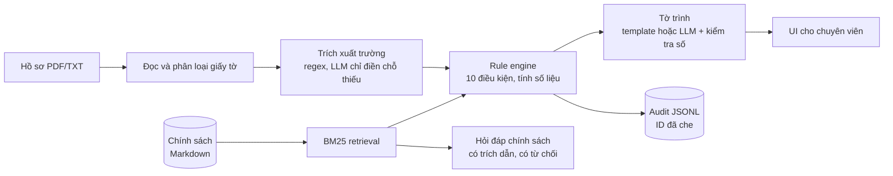

# Credit Copilot — Trợ lý thẩm định hồ sơ vay (demo)

[English summary](./README.en.md)

Bản demo cho thấy GenAI hỗ trợ **chuyên viên thẩm định tín dụng** như thế nào: đọc bộ hồ sơ vay, đối chiếu với chính sách cho vay, kiểm tra từng điều kiện, rồi soạn sẵn tờ trình. Mỗi kết luận đều chỉ ra **lấy từ trang nào của hồ sơ** và **căn cứ điều khoản nào**.

> **Phạm vi trung thực:** dữ liệu khách hàng, giấy tờ và chính sách đều là **giả lập**. Không kết nối ngân hàng, LOS hay core banking (T24) thật. Chế độ mặc định chạy **offline, không cần API key**. Đường Gemini/OpenAI đã được kiểm thử bằng LLM giả lập (mock) trong test, **chưa chạy với khóa API thật**. Công cụ chỉ **đề xuất**; quyết định cấp tín dụng thuộc về con người (Điều 6.4).

## Demo cho khách hàng ngân hàng: kịch bản 5 phút

| Bước | Thao tác | Điểm cần nhấn mạnh |
| --- | --- | --- |
| 1 | Chọn **HS-001** | Hồ sơ đạt 10/10 điều kiện. Mở "xem điều khoản và bằng chứng" của dòng DTI: thấy công thức, số liệu và dòng gốc trong sao kê |
| 2 | Chọn **HS-002** | Thu nhập cao nhưng DTI 57,3% > 50% nên bị đề xuất từ chối. Con số do code tính, không phải do LLM |
| 3 | Chọn **HS-003** | Số CCCD trên giấy đề nghị khác căn cước, sao kê chỉ có 2 kỳ lương. Copilot liệt kê việc cần làm với khách hàng |
| 4 | Chọn **HS-004** | Quá tuổi và vượt hạn mức 12 lần thu nhập. CCCD "Không thời hạn" vẫn được hiểu đúng |
| 5 | Hỏi chính sách: "Khách 62 tuổi có vay được không?" rồi "Giá vàng hôm nay" | Câu thứ nhất trả lời kèm Điều 3.1; câu thứ hai bị **từ chối** vì ngoài phạm vi chính sách |
| 6 | Xem **Nhật ký audit** | Mỗi lần thẩm định đều được ghi lại, số CCCD đã được che |

## Kiến trúc



**Nguyên tắc thiết kế:**

- **LLM không quyết định và không tính toán.** Thu nhập, khoản trả góp, DTI và kết luận đạt hay không đạt đều do `app/rules.py` tính. LLM (nếu bật) chỉ viết lại phần tóm tắt.
- **Chống bịa số:** mọi con số trong tờ trình do LLM viết phải có trong dữ liệu đã tính hoặc trong điều khoản được trích. Nếu có số lạ, hệ thống bỏ bản LLM và dùng mẫu cố định (`app/memo.py`).
- **Chống bịa trích xuất:** khi LLM được phép đọc hồ sơ, mỗi trường phải kèm một dòng trích nguyên văn có thật trong tài liệu, và giá trị được đọc lại từ dòng đó bằng code (`app/extraction.py`).
- **Dữ liệu không rời ngân hàng nếu chưa cho phép:** mặc định không gửi nội dung hồ sơ cho LLM (`LLM_SEND_DOCUMENTS=false`, theo Điều 7.2). Khi viết tờ trình, LLM chỉ nhận số liệu đã che tên và số CCCD.
- **Có thể dùng LLM on-premise:** `LLM_PROVIDER=openai` chạy được với mọi server tương thích OpenAI như vLLM hoặc Ollama trong mạng nội bộ.

**Vị trí trong kiến trúc ngân hàng:** Copilot là một service đứng cạnh hệ thống khởi tạo khoản vay (LOS). Khi triển khai thật, nó nhận hồ sơ từ LOS hoặc kho tài liệu, và nếu cần đối chiếu dữ liệu khách hàng thì gọi **API chỉ đọc** của lớp tích hợp. Nó không ghi gì vào core banking.

## Chạy thử

Yêu cầu Python 3.11+.

```bash
cd bank-credit-copilot
python -m venv .venv
# Windows: .venv\Scripts\activate    macOS/Linux: source .venv/bin/activate
pip install -r requirements.txt
uvicorn app.main:app --reload
```

Mở http://127.0.0.1:8000. Hồ sơ mẫu được thẩm định với ngày cố định 26/11/2026 vì giấy tờ giả lập được ghi ngày theo mốc này. Hồ sơ tải lên dùng ngày hiện tại.

**Bật LLM (tùy chọn):** chép `.env.example` thành `.env` rồi điền khóa:

```env
LLM_PROVIDER=gemini
GEMINI_API_KEY=...
```

**Test và đánh giá:**

```bash
pip install -r requirements-dev.txt
python -m pytest -q
python scripts/evaluate.py        # ghi eval/results.json
python scripts/generate_samples.py   # tạo lại PDF mẫu (cần reportlab và font DejaVuSans)
```

## Kết quả đánh giá (chế độ offline)

`scripts/evaluate.py` chạy trên 4 hồ sơ mẫu và 16 câu hỏi chính sách (`eval/golden.json`):

| Chỉ số | Kết quả |
| --- | --- |
| Độ chính xác trích xuất trường | 100% (20/20) |
| Độ chính xác từng điều kiện | 100% (25/25) |
| Độ chính xác kết luận | 100% (4/4) |
| Trả lời đúng điều khoản hoặc từ chối đúng | 93,8% (15/16) |

Câu sai duy nhất là "Mở thẻ tín dụng cần gì": tìm kiếm theo từ khóa nhầm "thẻ tín dụng" với "cấp tín dụng" (Điều 6.4) thay vì từ chối. Đây là giới hạn đã biết của BM25. Tìm kiếm bằng embedding sẽ khắc phục được.

**Lưu ý:** 4 hồ sơ mẫu do chính dự án tạo ra với nhãn rõ ràng, nên 100% ở đây chỉ chứng minh logic đúng, **không** chứng minh độ chính xác trên hồ sơ thật (ảnh chụp, scan, mẫu của nhiều ngân hàng).

## Cấu trúc thư mục

| Đường dẫn | Nội dung |
| --- | --- |
| `app/documents.py` | Đọc PDF/TXT, nhận diện loại giấy tờ |
| `app/extraction.py` | Trích xuất trường kèm nguồn; LLM điền chỗ thiếu có kiểm tra trích dẫn |
| `app/rules.py` | 10 điều kiện tín dụng, tính DTI theo niên kim |
| `app/policy.py` | Tách chính sách thành điều khoản, BM25, từ đồng nghĩa nhỏ |
| `app/memo.py` | Tờ trình: mẫu cố định hoặc LLM có kiểm tra số |
| `app/pipeline.py` | Ghép toàn bộ luồng, hỏi đáp chính sách, ghi audit |
| `app/llm.py` | Gemini / OpenAI-compatible qua thư viện chuẩn |
| `policies/consumer_loan_policy.md` | Chính sách giả lập CS-TC-2026.1 |
| `samples/` | 4 bộ hồ sơ PDF giả lập (có dòng "DỮ LIỆU GIẢ LẬP" trên mỗi trang) |

## Cần làm thêm để dùng thật

1. OCR cho ảnh chụp và PDF scan (ví dụ PaddleOCR, VietOCR hoặc LLM đa phương thức chạy nội bộ), có bước người kiểm tra lại các trường độ tin cậy thấp.
2. Thay BM25 bằng tìm kiếm lai BM25 + embedding tiếng Việt (Qdrant/pgvector), quản lý phiên bản chính sách.
3. Kết nối LOS và API chỉ đọc của lớp tích hợp (thông tin khách hàng, dư nợ hiện tại, CIC) thay cho số liệu khách hàng tự khai.
4. Đăng nhập SSO, phân quyền theo vai trò, lưu audit vào kho không sửa được.
5. Đánh giá trên hồ sơ thật đã ẩn danh, đo thời gian thẩm định trước và sau khi dùng.
