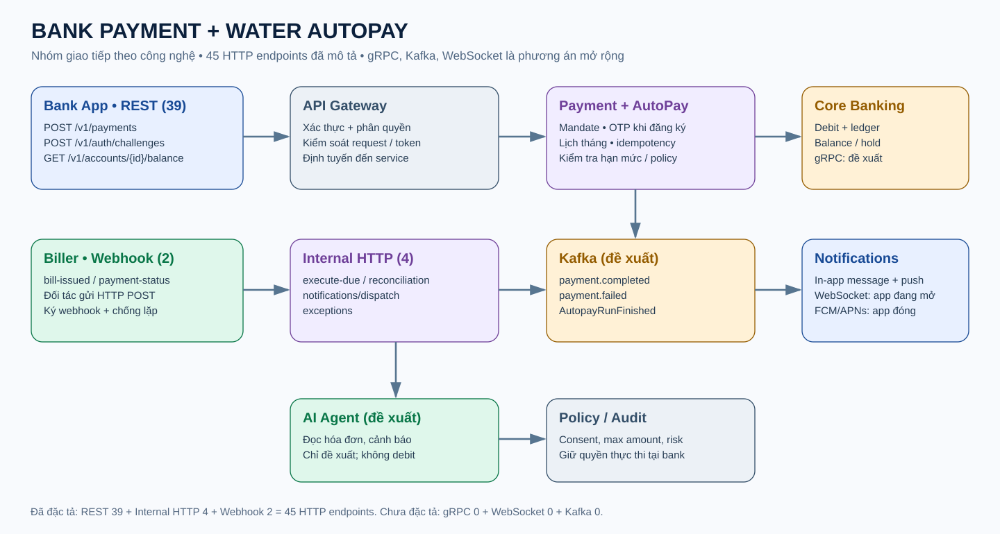
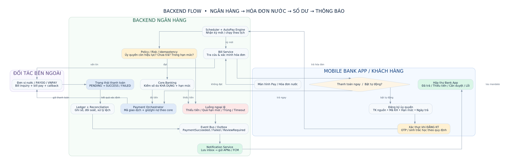
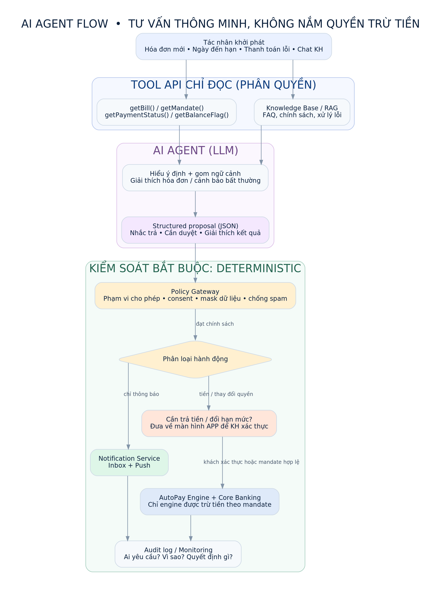

# Bank Payment + Water AutoPay — 45 API & AI Agent Flow

> **Trạng thái: kiến trúc tham khảo + CLI mô phỏng offline.** Không kết nối ngân hàng thật, không trừ tiền, không gửi notification thật. Các endpoint là đề xuất thiết kế, không phải đặc tả của một ngân hàng cụ thể.

## Xem toàn bộ hệ thống và danh sách 45 API

- **[Toàn bộ hệ thống: Payment → OTP → Trừ tiền → Cập nhật số dư → Thông báo → AutoPay](./index.html)** — trang HTML tổng quan và danh mục 45 API.
- **[Danh sách 45 API phân loại theo công nghệ](./api_by_protocol.html)** — có bộ lọc REST / Internal HTTP / Webhook, tìm endpoint.
- **[Danh mục máy đọc JSON](./api_catalog.json)** — 45 endpoint, method, mục đích, nhóm, protocol.

> Tải folder về hoặc clone repo rồi mở `index.html` / `api_by_protocol.html` bằng trình duyệt. GitHub chỉ hiển thị mã HTML, không chạy trang HTML trong giao diện xem file.

## 1. API phân nhóm công nghệ



| Công nghệ | Số endpoint trong danh mục gốc | Vai trò |
| --- | ---: | --- |
| REST-style HTTP | **39** | App → API Gateway: login, OTP, số dư, hóa đơn, Payment, Mandate, Notifications |
| Internal HTTP | **4** | Backend ↔ Backend: AutoPay trigger, reconciliation, notification dispatch, exceptions |
| Webhook (HTTP callback) | **2** | Đơn vị nước → Backend: `bill-issued`, `payment-status` |
| gRPC | **0 (đề xuất)** | RPC giữa các service: kiểm tra số dư, risk/policy, posting |
| WebSocket | **0 (đề xuất)** | Đẩy trạng thái đến Bank App khi app đang mở |
| Kafka events | **0 (đề xuất)** | Event bất đồng bộ: payment.completed, notification, audit, reconciliation |

**45 dòng = 45 HTTP endpoints** (REST-style + internal HTTP + webhook), không có nghĩa mỗi giao dịch chạy hết 45 endpoint. REST, gRPC và WebSocket là giao thức/kiểu giao tiếp; Kafka là event broker. Push notification (FCM/APNs) là kênh thông báo cho app đang đóng.

## 2. Backend flow — Payment → OTP → Debit → Balance → Notify



**Thanh toán thủ công:**

1. Bank App → `POST /v1/payments/quotes`: lấy số tiền và phí.
2. Bank App → `POST /v1/payments`: tạo giao dịch, truyền idempotency key.
3. Khi chính sách yêu cầu: `POST /v1/auth/challenges` → `POST /v1/auth/challenges/{id}/verify`: xác thực OTP/step-up.
4. `POST /v1/payments/{id}/confirm` → Payment Orchestrator kiểm tra hạn mức/rủi ro → Core Banking ghi nợ **một lần** và ghi ledger.
5. `GET /v1/payments/{id}`, `GET /v1/accounts/{id}/balance`: lấy trạng thái và số dư mới.
6. Gửi sự kiện hoàn tất → cập nhật Inbox `GET /v1/notifications` + push notification; chờ xác nhận biller, đối soát khi cần.

**Thanh toán nước tự động hằng tháng (AutoPay):**

1. Khách đăng ký `POST /v1/autopay/mandates` và xác thực quyền trích nợ, đặt tài khoản nguồn, đơn vị nước, hạn mức, lịch, quyền hủy.
2. Scheduler hoặc sự kiện webhook `POST /webhooks/billers/bill-issued` phát hiện hóa đơn đến hạn.
3. AutoPay Engine kiểm tra ủy quyền còn hiệu lực, invoice chưa trả, không vượt hạn mức, số dư đủ, policy hợp lệ.
4. Engine gửi lệnh thanh toán **theo ủy quyền có sẵn**, không lấy OTP mới mỗi tháng trừ khi chính sách/ngân hàng yêu cầu.
5. Xác nhận Core Banking, kết quả biller; ghi ledger và trừ số dư đúng một lần, đối soát `POST /internal/reconciliation/run`.
6. Ghi tin nhắn trong Bank App + push trước/sau thanh toán; khi thất bại thì báo nguyên nhân và retry có kiểm soát. Không được tự debit lại khi timeout chưa rõ trạng thái.

**Quan trọng:** `SUCCESS` trong hệ thống thật đòi hỏi trạng thái cuối hợp lệ và quy tắc xác nhận/đối soát đã được thiết kế rõ; không chỉ vì một HTTP request trả 200.

## 3. AI Agent Flow — Một agent, không có quyền debit



- **01 AI Agent (LLM — Large Language Model, mô hình ngôn ngữ lớn)** đọc hóa đơn, lịch, số dư được phép truy cập; tóm tắt, cảnh báo bất thường, gợi ý nhắc thanh toán.
- **Policy Gateway / Risk Engine** là backend rules, không phải AI Agent; quyết định giao dịch có phù hợp ủy quyền và hạn mức không.
- **AutoPay Engine + Core Banking** mới được xử lý lệnh thanh toán. AI Agent không gọi lệnh ghi nợ, không tạo OTP, không tự thay đổi consent.
- Phần AI là **flow đề xuất**, chưa có LLM thật trong demo CLI.

## 4. Chạy automation mô phỏng (không cần tài khoản ngân hàng)

Dùng Python 3.10+ và thư viện chuẩn, không cần API key:

```bash
cd bank-payment-water-autopay
python autopay_demo.py --period 2026-11 --amount 189000
python autopay_demo.py --period 2026-11 --amount 189000
python -m unittest discover -s tests -v
```

- Lần 1: nếu mandate hợp lệ và số dư đủ, mô phỏng ghi nợ 189.000đ, cập nhật `data/state.json`, tạo message `AUTOPAY_SUCCESS`.
- Lần 2 cùng kỳ: `ALREADY_PAID`, không trừ hai lần.
- Thử `--amount 700000`: vượt hạn mức 500.000đ → `LIMIT_EXCEEDED` (nếu kỳ đó chưa trả).
- Test kiểm tra duplicate, vượt hạn mức, thiếu tiền, mandate bị tắt. Xóa `data/state.json` để reset demo.

Để thử chạy định kỳ trên máy cá nhân, có thể gọi CLI này từ Windows Task Scheduler hoặc cron mỗi tháng. **Mã demo không phải scheduled job đang hoạt động trong GitHub** và không có credential/kết nối vào API ngân hàng.

## 5. Cấu trúc project

```text
bank-payment-water-autopay/
├── README.md
├── index.html                    # full backend/payment/45 endpoints
├── api_by_protocol.html          # bộ lọc nhóm công nghệ
├── api_catalog.json              # machine-readable 45 endpoints
├── autopay_demo.py               # offline monthly billing simulation
├── tests/test_autopay_demo.py
├── docs/api_protocol_groups.svg  # sơ đồ nhóm công nghệ
└── assets/
    ├── backend_flow.png
    └── ai_agent_flow.png
```

## 6. Phạm vi và lưu ý production

- Cần onboarding chính thức của ngân hàng và biller, giấy phép/phân quyền, contract API, eKYC/consent theo yêu cầu.
- Cần authentication mạnh, ký và xác minh webhook, idempotency bền vững, transaction isolation, retry/backoff, DLQ, ledger, đối soát và audit logs.
- WebSocket chỉ dùng khi app có kết nối; push notification dùng kênh mobile thích hợp.
- Demo `state.json` chỉ dành cho **một process offline**; không có khóa đồng thời, HSM, DB transaction hay cam kết bảo toàn tài chính production.
- Không hardcode tài khoản thật, OTP, token, secret hoặc thông tin nhận dạng khách hàng.

**Ngày tài liệu:** 2026-11-03 • **Mục tiêu:** portfolio architecture & lab thiết kế AutoPay ngân hàng.
