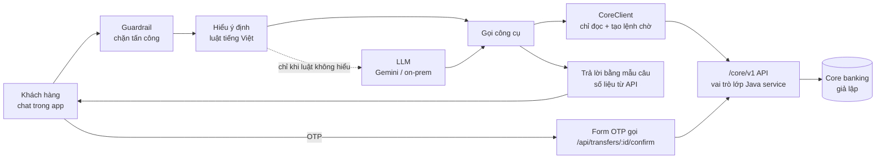

# Trợ lý ảo ngân hàng — chat có chuyển tiền bằng OTP (demo)

[English summary](./README.en.md)

Bản demo một trợ lý chat trong app ngân hàng. Khách hàng hỏi bằng tiếng Việt (có dấu hoặc không dấu, viết tắt như "500k", "1tr5", "ck"), trợ lý gọi **API của hệ thống lõi** để lấy số dư và giao dịch thật của tài khoản, và **soạn sẵn** lệnh chuyển tiền. Lệnh chỉ được thực hiện khi chính khách hàng nhập OTP.

> **Phạm vi trung thực:** khách hàng, tài khoản, giao dịch và danh bạ đều là **giả lập**. "Core banking" ở đây là một service Python trong bộ nhớ đóng vai lớp API của ngân hàng, không phải T24 hay hệ thống thật. OTP được hiện trong một "SMS giả lập" để có thể demo trên trình duyệt. Chế độ mặc định chạy **offline, không cần API key**. Đường gọi LLM chỉ được kiểm thử với LLM giả lập (mock), **chưa chạy với khóa API thật**.

## Demo cho khách hàng ngân hàng: kịch bản 5 phút

| Bước | Gõ vào chat | Điểm cần nhấn mạnh |
| --- | --- | --- |
| 1 | `Số dư của tôi` | Số tiền lấy từ API lõi. Bảng "Bên trong hệ thống" cho thấy guardrail → hiểu ý định → gọi `get_balance` |
| 2 | `Tháng này tôi tiêu bao nhiêu?` rồi `Chi ăn uống tháng trước` | Thống kê theo nhóm; chuyển khoản và lương không bị tính là chi tiêu |
| 3 | `chuyen 1tr5 cho lan nhe` | Hiểu tiếng Việt không dấu, viết tắt. Thẻ xác nhận hiện ra, **chưa trừ tiền** |
| 4 | Nhập OTP từ "SMS giả lập" | Sai OTP 3 lần thì khóa lệnh; OTP hết hạn sau 3 phút; bấm xác nhận 2 lần không bị trừ 2 lần |
| 5 | `Chuyển 2 triệu cho chị Hoa` | Người lạ không có trong danh bạ thì không chuyển, trợ lý hỏi lại người nhận |
| 6 | Bấm các nút "Thử kịch bản tấn công" | Bỏ qua OTP, prompt injection, xem tài khoản người khác, chuyển tới số tài khoản lạ, dán OTP vào chat: tất cả bị chặn **trước khi** tới LLM hay API lõi |
| 7 | Xem **Nhật ký audit** | Mọi lượt chat và sự kiện bảo mật được ghi lại, số tài khoản và OTP đã được che |

## Kiến trúc



**Nguyên tắc thiết kế (đúng như kiến trúc ngân hàng thật):**

- **Trợ lý không bao giờ gọi thẳng vào core.** Nó chỉ có một `CoreClient` với vài thao tác được phép: đọc số dư, đọc giao dịch, đọc danh bạ, tạo lệnh chờ và hủy lệnh. **Không có thao tác xác nhận chuyển tiền** trên client này (`app/core_client.py`). Chỉ form OTP do khách hàng bấm mới gọi được API xác nhận.
- **Đổi sang gọi HTTP chỉ bằng một biến môi trường:** đặt `CORE_BASE_URL` thì trợ lý gọi `/core/v1/*` qua REST, giống một service AI bằng Python gọi API của team Java.
- **LLM không viết con số.** Câu trả lời được ghép từ mẫu câu cố định với số liệu từ API. LLM (nếu bật) chỉ được dùng để hiểu những tin nhắn mà bộ luật không hiểu. Số tiền mà LLM đưa ra chỉ được chấp nhận khi đoạn chữ đó có thật trong tin nhắn và bộ luật đọc ra cùng con số.
- **Guardrail chạy đầu tiên.** Tin nhắn bị chặn không bao giờ tới LLM hay API lõi, nên prompt injection không thể thay đổi hành vi của trợ lý.
- **Hạn mức do core kiểm soát:** tối đa 50 triệu mỗi lệnh, 100 triệu mỗi ngày, không vượt số dư. Mỗi cuộc chat chỉ có một lệnh chờ; tạo lệnh mới thì lệnh cũ tự hủy.

## Chạy thử

Yêu cầu Python 3.11+.

```bash
cd bank-virtual-assistant
python -m venv .venv
# Windows: .venv\Scripts\activate    macOS/Linux: source .venv/bin/activate
pip install -r requirements.txt
uvicorn app.main:app --reload
```

Mở http://127.0.0.1:8000 (giao diện chat) hoặc http://127.0.0.1:8000/docs (API lõi giả lập và API chat). Dữ liệu giao dịch được sinh cho 3 tháng gần nhất tính tới lúc khởi động, nên lúc nào demo cũng có số liệu "tháng này".

**Bật LLM (tùy chọn):** chép `.env.example` thành `.env`, đặt `LLM_PROVIDER=gemini` và `GEMINI_API_KEY`, hoặc `LLM_PROVIDER=openai` với `OPENAI_BASE_URL` trỏ tới server vLLM/Ollama nội bộ.

**Test và đánh giá:**

```bash
pip install -r requirements-dev.txt
python -m pytest -q
python scripts/evaluate.py      # ghi eval/results.json
```

## Kết quả đánh giá (chế độ offline)

`scripts/evaluate.py` dùng `eval/cases.json`:

| Chỉ số | Kết quả |
| --- | --- |
| Hiểu đúng ý định (25 câu) | 100% |
| Trích đúng tham số: số tiền, người nhận, nhóm chi, kỳ (28 kiểm tra) | 100% |
| Chặn đúng loại tấn công (12 câu) | 100% |
| Chặn nhầm câu hỏi bình thường | 0% |
| Hội thoại nhiều lượt đi đúng kết quả (3 kịch bản) | 100% |

**Lưu ý:** bộ câu đánh giá do chính dự án viết song song với bộ luật, nên đây là kiểm tra hồi quy, **không** phải đo độ chính xác trên tin nhắn thật của khách hàng. Bộ luật vẫn bỏ sót những cách nói chưa gặp; đó là lý do có đường LLM dự phòng. Guardrail dựa trên cụm từ khóa nên kẻ tấn công có thể viết lách để né; lớp bảo vệ thật sự là việc trợ lý **không có quyền** xác nhận chuyển tiền hay chuyển cho người ngoài danh bạ.

## Cấu trúc thư mục

| Đường dẫn | Nội dung |
| --- | --- |
| `app/core_bank.py` | Core giả lập: tài khoản, giao dịch 3 tháng, danh bạ, hạn mức, OTP (hết hạn, khóa sau 3 lần sai, idempotent) |
| `app/core_client.py` | Client giới hạn quyền: chạy trong tiến trình hoặc qua HTTP |
| `app/nlu.py` | Hiểu tiếng Việt bằng luật: số tiền ("500k", "1tr5", "2 củ"), người nhận, nhóm chi, kỳ thời gian |
| `app/llm_nlu.py` | LLM dự phòng, kiểm tra số tiền và người nhận trước khi dùng |
| `app/guardrails.py` | Chặn bỏ qua OTP, prompt injection, dữ liệu người khác, người nhận lạ, OTP trong chat, tư vấn đầu tư |
| `app/agent.py` | Điều phối: guardrail → ý định → công cụ → câu trả lời, kèm trace |
| `app/main.py` | FastAPI: `/api/chat`, xác nhận OTP, `/core/v1/*` giả lập, audit |

## Cần làm thêm để dùng thật

1. Thay core giả lập bằng API thật của lớp tích hợp (qua API gateway, OAuth2, mTLS); OTP/Smart OTP do hệ thống xác thực của ngân hàng phát hành, không hiển thị trong app chat.
2. Phân loại giao dịch theo mã MCC thay vì tên cửa hàng; dùng dữ liệu đã được ngân hàng phân loại.
3. Bộ phân loại prompt injection bằng mô hình (không chỉ từ khóa), red-team định kỳ.
4. Lưu phiên và audit vào kho tập trung (Redis/Kafka → SIEM), giới hạn tần suất theo khách hàng.
5. Đánh giá trên log chat thật đã ẩn danh; đo tỷ lệ hiểu đúng, tỷ lệ chuyển cho nhân viên và mức hài lòng.
