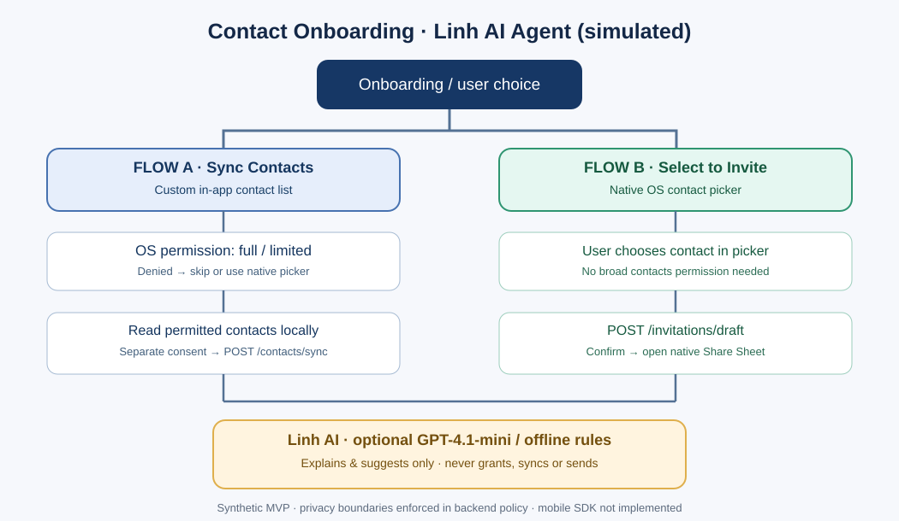
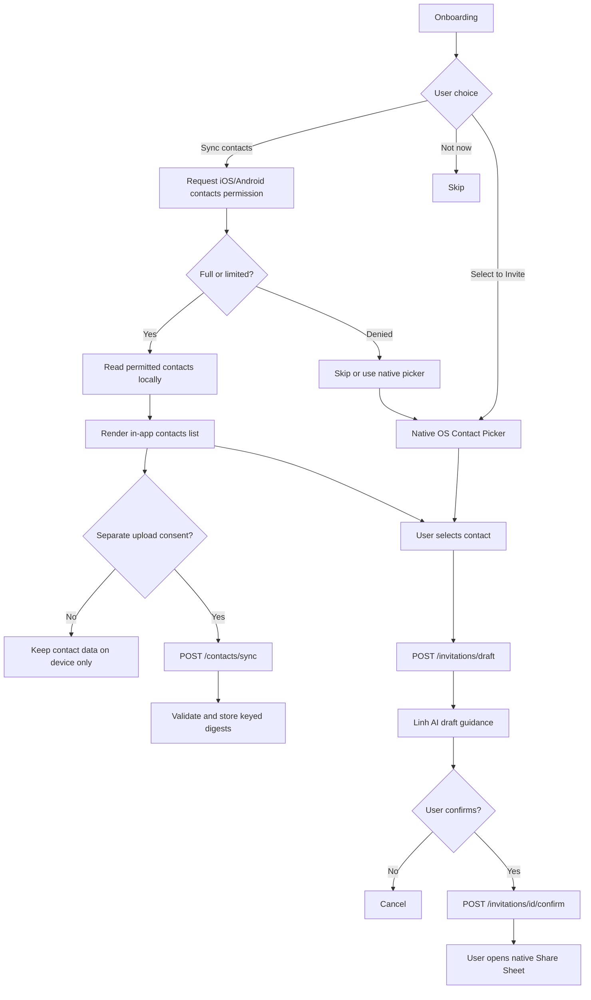
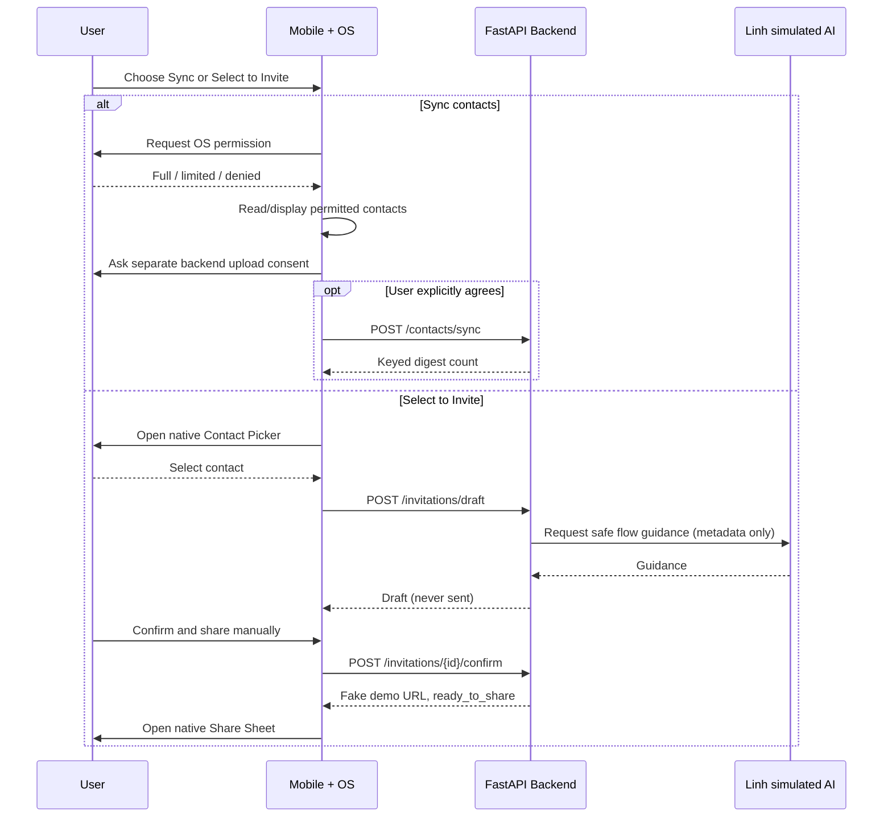

# Linh — Contact Sync & Invite Onboarding AI Agent (MVP)

> **Status:** runnable **offline prototype** with synthetic data. **Linh is a simulated AI character**, NOT a real person or a VietPay employee. No real iOS/Android contacts, SMS/Zalo delivery, registration tracking, or production users are connected.

This project implements a privacy-first FastAPI backend for a referral onboarding funnel with **two independent user journeys**. The mobile OS handles native permissions and picker UI; the backend validates consent and handles draft data; Linh AI explains the choice but **cannot** authorize access, sync on its own, or send invitations.



## 1. Two independent flows — 2 luồng onboarding

| | **A. Sync Contacts / Hiển thị trong app** | **B. Select to Invite / Chọn người để mời** |
|---|---|---|
| Goal | Read authorized address-book entries and display an in-app contact list | Select contact(s) using system-owned contact picker and prepare an invitation |
| OS permission | **Required** for app-managed address-book reading (full or limited, where supported) | **No broad contact permission** for a native system picker; user chooses specific entries |
| Server upload | **Optional**, after **additional explicit consent** | Does not require prior contact sync |
| Backend route | `POST /contacts/sync` | `POST /invitations/draft` then `POST /invitations/{id}/confirm` |
| Stored in prototype | Keyed HMAC digests only, not plain numbers/names | First name + masked phone in volatile draft state |
| User control | Deny / Limited / Skip / Delete uploaded digests | Cancel / Confirm / Open native Share Sheet |
| Automatic external sending | **Never** | **Never** |

**Critical distinction:** displaying contacts **locally** in the app is not the same as transmitting them to backend. On the Sync path, an OS permission allows the app to read permitted entries; uploading to backend is **separate opt-in**. On the Invite path, opening the OS picker can be done without asking to read the entire address book. Both paths always have a **Not now** exit.

### Flowchart



### Mobile engineering notes

- **iOS:** use `CNContactPickerViewController` for user-selected contacts, or Contacts framework permission when the app reads an address book itself.
- **Android:** use the supported system contact picker / `ACTION_PICK` for user-driven selection without broad `READ_CONTACTS`; use the relevant contact permission for app-managed list access. Verify Android-version-specific picker capabilities before choosing an implementation.
- **The backend cannot check the real mobile OS grant.** The demo accepts a claimed permission field; production must implement native permissions + independent consent UX, authenticated server-side authorization, auditing and abuse controls.
- **No platform client is implemented here.** The project demonstrates API policy and a simulated assistant, not a published mobile app.

## 2. AI model — Linh là AI giả lập

| Item | MVP implementation |
|---|---|
| Character/persona | **Linh**, a clearly disclosed **simulated AI onboarding guide** (not human) |
| Default runtime | `rules_demo` — deterministic local guidance; **offline, no key, no LLM call** |
| Optional LLM | **OpenAI `gpt-4.1-mini`** using the Chat Completions API; opt in by setting `OPENAI_API_KEY` and optionally `OPENAI_MODEL` |
| LLM inputs | Only `flow`, `permission`, `selected_count`, `language` — **no contact names or phone numbers** |
| LLM output | Explanation and safe next-step guidance; never grants access or sends a message |
| Fallback | If model call fails, rule-based guidance responds |
| AI responsibility | Explain permission choice and distinguish sync vs picker; draft wording support is rule-driven in this MVP |

**This is a single guided agent demo, not a trained custom model or production multi-agent platform.** The prompt defines the behavior of the Linh persona. For genuinely personalized invitation generation, add a separate **user-reviewed, privacy-assessed** drafting path later.

### Backend + Linh sequence



## 3. API (backend tự viết)

| Method | API | Responsibility |
|---|---|---|
| GET | `/health` | Demo/agent readiness |
| POST | `/agent/linh/guide` | Simulated Linh explanation for sync/invite/skip |
| POST | `/contacts/sync` | Explicit opt-in sync, normalize/dedupe by HMAC digest |
| GET | `/contacts/sync/summary` | Get aggregate digest count |
| DELETE | `/contacts/sync` | Remove synced digest data for demo owner |
| POST | `/invitations/draft` | Create invite after explicit contact selection |
| POST | `/invitations/{id}/confirm` | Mark ready-to-share, **no external sending** |
| GET | `/invitations/{id}` | Owner-scoped demo invite status |

**State machine:** contact not synced or local-only → optional synced digests; invitation `draft` → `ready_to_share`. Registered/referral commission is **not implemented** and is not simulated as a real delivery event.

## 4. Run locally (Python 3.10+)

```bash
cd contact-onboarding-linh-agent
python -m venv .venv
# Windows PowerShell: .venv\Scripts\Activate.ps1
# macOS/Linux: source .venv/bin/activate
python -m pip install -r requirements-dev.txt
python -m uvicorn app.main:app --reload
```

Visit **http://127.0.0.1:8000/docs** to try API requests. By default the agent runs without OpenAI, with synthetic inputs.

### A — Explain picker (no permission needed for broad address book)

```bash
curl -X POST http://127.0.0.1:8000/agent/linh/guide -H "Content-Type: application/json" -d '{"flow":"invite","permission":"not_requested","selected_count":1,"language":"vi"}'
```

### B — Optional sync after explicit permission and separate consent

```bash
curl -X POST http://127.0.0.1:8000/contacts/sync -H "Content-Type: application/json" -d '{"permission":"limited","sync_consent":true,"contacts":[{"name":"Demo A","phone":"0901234567"}]}'
```

### C — Native-picker invite without sync

```bash
curl -X POST http://127.0.0.1:8000/invitations/draft -H "Content-Type: application/json" -d '{"contact":{"name":"Demo B","phone":"0901234567"},"source":"native_picker","user_selected":true}'
```

Then call `POST /invitations/{id}/confirm` with the returned ID. **The URL is on `example.invalid`: it cannot deliver or track a real referral.**

## 5. Third-party integrations

| Tool / service | Used in this demo? | Production responsibility |
|---|---|---|
| iOS/Android native Contacts + Picker | **No real SDK integration** | Permissions and selection live on phone, not AI |
| FastAPI | **Yes** | REST endpoint implementation |
| OpenAI `gpt-4.1-mini` | **Optional, if configured** | Guidance using non-PII metadata |
| PostgreSQL | **No** | Future tenant-scoped, encrypted, expiring persistence |
| SMS / Zalo or a messaging provider | **No** | Later, only user-initiated delivery with opt-out |
| Referral/deep-link provider | **No** | Later, link attribution and registration tracking |

## 6. Tests, privacy and limitations

```bash
python -m pytest -q
```

The suite exercises 8 test cases including consent rejection, limited permission, normalization/duplicates, erasure, owner separation, picker without sync, explicit user selection, confirmation without sending, and invalid numbers.

**Do not expose this example as a real contact API.** Data is stored in Python process memory; demo owner header is not authentication; the fallback HMAC secret is insecure for production; the upload-consent/permission booleans are client assertions rather than independent proof. A real service needs validated login and authorization, OS SDK flows, consent records, encrypted scoped storage, retention/deletion policies, replay/rate limiting, message abuse controls and privacy review. No real contacts are imported by this project.

## 7. Portfolio description

*Linh Contact Onboarding AI Agent (MVP)* — FastAPI demo of two independent mobile referral onboarding paths: permission-gated contacts sync and native-picker invite. Simulated Linh AI uses deterministic fallback with optional OpenAI GPT-4.1-mini guidance; explicit consent, redacted contact handling and human-confirmed sharing. No live mobile or messaging integration.
