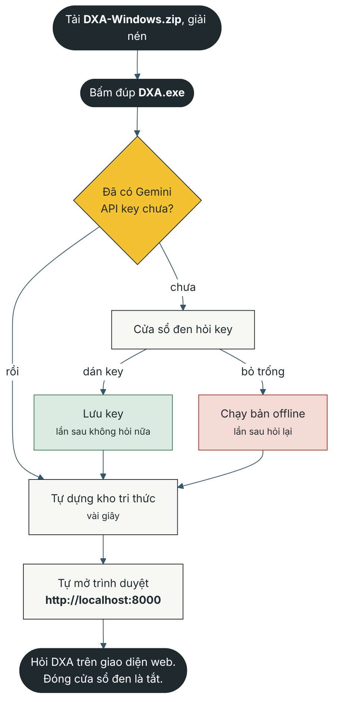
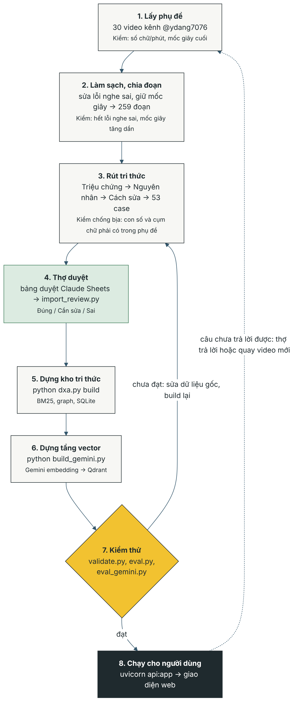
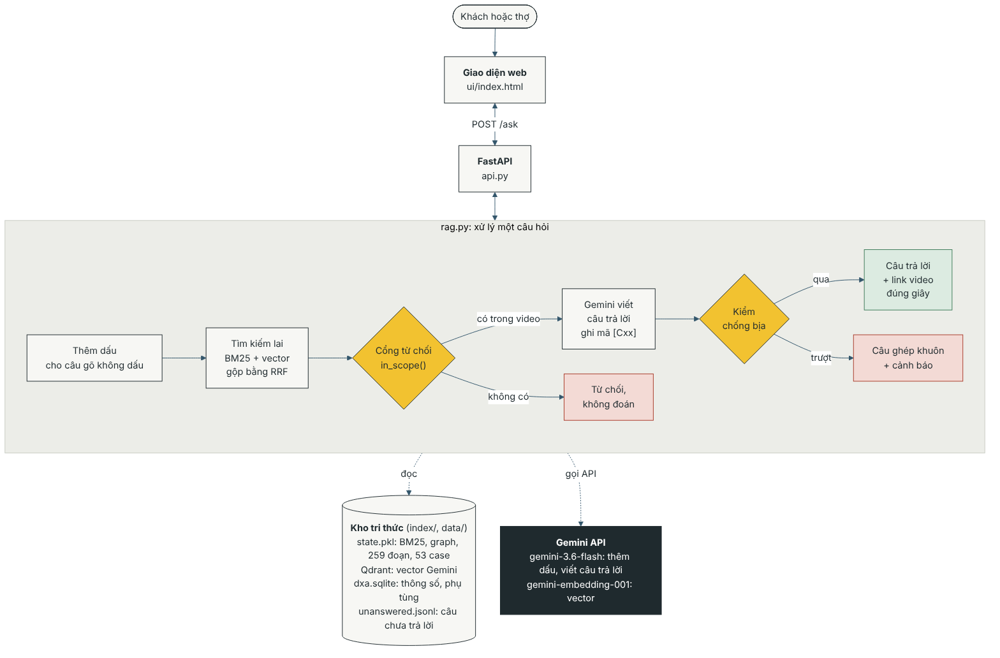

# DXA – Hỏi thợ sửa xe máy

## Chạy DXA

1. Tải [DXA-Windows.zip](https://github.com/ydangishere/dev-projects/releases/download/dxa-windows/DXA-Windows.zip), giải nén.
2. Bấm đúp **`DXA.exe`**.
3. Dán Gemini API key rồi bấm Enter (hoặc bấm Enter để bỏ qua).
4. Trình duyệt tự mở DXA. Gõ câu hỏi, bấm **Hỏi thợ**.

## Luồng chạy khi bấm DXA.exe

## Các bước dựng DXA

## Kiến trúc DXA

