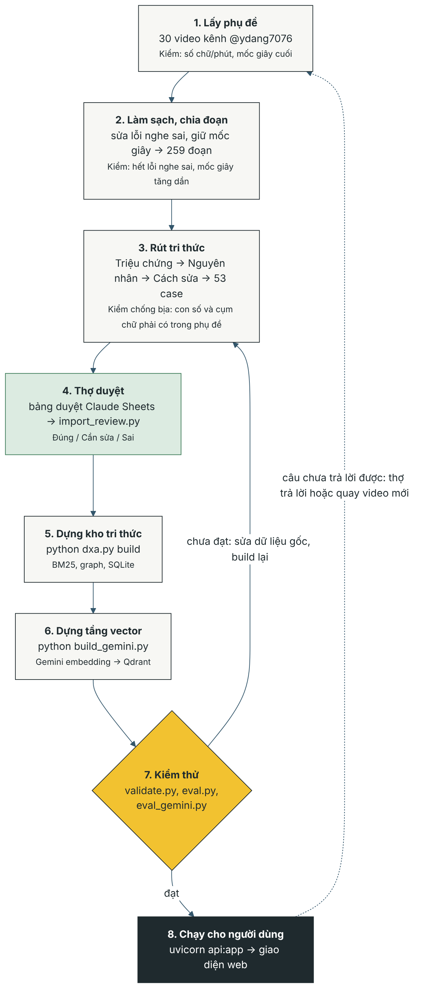
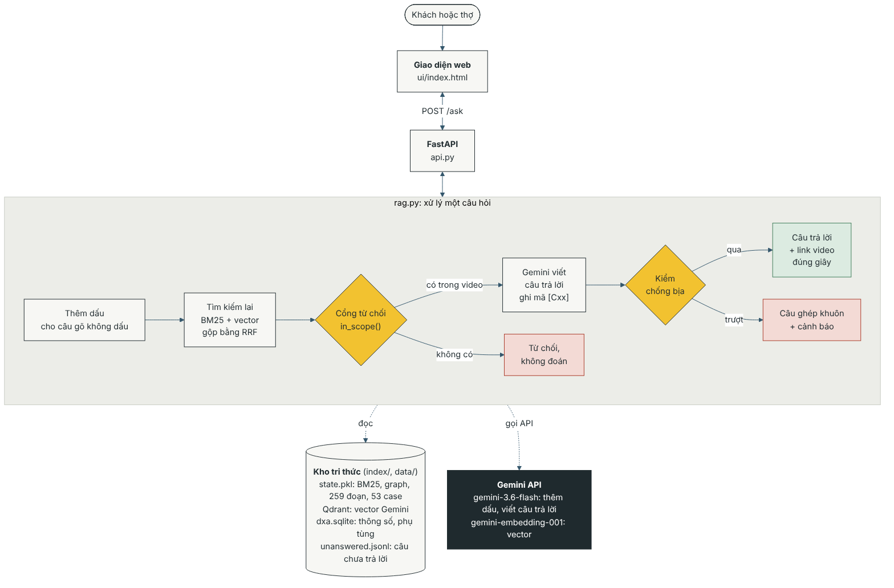

# DXA – Tài liệu kỹ thuật

Tài liệu này dành cho người cài đặt, sửa code hoặc nạp thêm video.
Người dùng bình thường chỉ cần đọc [README](../README.md).

Gói `DXA.exe` được GitHub Actions tự đóng gói và chạy thử trên máy Windows mỗi khi code thay đổi (xem `.github/workflows/dxa-windows.yml` ở gốc repo).

## Chạy từ mã nguồn

Clone repo, mở thư mục `dxa-automative-agent`, rồi bấm đúp `run.bat` (Windows) hoặc `run.command` (macOS).
File này tự tạo môi trường Python riêng, cài thư viện ở lần đầu, hỏi key, rồi mở trình duyệt.
Cần có Python 3.10 trở lên; nếu máy chưa có, `run.bat` sẽ hỏi trước khi tự cài.

## Chạy bằng tay

Cần Python 3.10 trở lên.

```bash
pip install -r requirements.txt
echo GEMINI_API_KEY=AIza... > .env   # bỏ qua dòng này nếu chạy offline
python dxa.py build                  # dựng kho tri thức: BM25, graph, SQLite
python build_gemini.py               # dựng tầng vector bằng Gemini, lưu vào Qdrant
uvicorn api:app --port 8000          # chạy máy chủ
```

Mở http://localhost:8000 để dùng giao diện web, hoặc http://localhost:8000/docs để thử API.
Không có key thì DXA vẫn chạy, nhưng dùng bản offline: tìm kiếm TF-IDF và câu trả lời ghép theo khuôn.

Hỏi nhanh trên dòng lệnh:

```bash
python rag.py "binh xang con buong ga ma ga khong ve"
```

## Các bước dựng DXA



1. **Lấy phụ đề** 30 video, giữ mốc giây.
2. **Làm sạch** lỗi nghe sai, rồi chia thành 259 đoạn.
3. **Rút tri thức** thành 53 case dạng Triệu chứng → Nguyên nhân → Cách sửa. Con số và câu chữ nào không có trong phụ đề đều bị bộ kiểm bắt lại.
4. **Thợ duyệt** từng case trên bảng duyệt, rồi `import_review.py` ghi kết quả vào dữ liệu.
5. **Dựng kho** và **tầng vector**, rồi **kiểm thử**. Chưa đạt thì sửa dữ liệu gốc và build lại.
6. **Chạy cho người dùng.** Câu nào chưa trả lời được thì được lưu lại, để thợ trả lời hoặc quay video mới.

## Cơ chế vận hành



Một câu hỏi đi qua 5 bước trong `rag.py`:

1. **Thêm dấu.** Câu gõ không dấu được Gemini thêm dấu. Gemini chỉ được thêm dấu, đổi chữ là bị bỏ.
2. **Tìm kiếm lai.** BM25 tìm theo chữ, vector Gemini tìm theo nghĩa. Hai kết quả được gộp lại.
3. **Cổng từ chối.** Câu hỏi không khớp case nào thì bị từ chối ngay, không gọi LLM.
4. **Gemini viết câu trả lời,** chỉ từ các case tìm được, và ghi mã case như `[C28]` sau mỗi ý.
5. **Kiểm chống bịa.** Câu trả lời có con số không nằm trong video thì bị bỏ. Lúc đó DXA trả bản ghép khuôn kèm cảnh báo.

Link video do code tự gắn, không nhờ LLM viết, nên luôn đúng.

## API

| Endpoint | Làm gì |
|---|---|
| `GET /` | Giao diện web |
| `POST /ask` | Hỏi: `{"question": "...", "use_llm": true}` |
| `GET /cases/{id}` | Xem một case, ví dụ `C28` |
| `GET /unanswered` | Các câu chưa trả lời được, cho thợ xem |
| `GET /health` | Chế độ đang chạy (gemini hoặc offline), số case, số video |

## Kiểm thử

```bash
python validate.py           # kiểm dữ liệu bước 1–4
python eval.py               # chấm hỏi đáp bản offline
python eval_gemini.py --llm  # chấm bản Gemini, đặt cạnh bản offline
```

Kết quả hiện tại:

| Bản | Kết quả |
|---|---|
| Kiểm dữ liệu (`validate.py`) | Cả 4 bước PASS: 30 video, 259 đoạn, 53 case |
| Offline (`eval.py`) | Đúng ngay vị trí đầu 38/39 câu, nằm trong top 3 39/39 câu, từ chối đúng 8/8 câu ngoài phạm vi |
| Gemini | Mới chạy với Gemini giả lập để kiểm code. Cần chạy `eval_gemini.py --llm` với key thật để có điểm |

Bộ câu hỏi chấm điểm do người dựng hệ thống viết, nên điểm sẽ cao hơn thực tế.
53 case mới được duyệt tạm, chưa có thợ xem kỹ.
Việc tiếp theo là lấy 30–50 câu hỏi thật từ bình luận YouTube để chấm.

## Thư mục

| Đường dẫn | Nội dung |
|---|---|
| `dxa.py` | Dựng kho tri thức, hỏi đáp bản offline |
| `rag.py` | Hỏi đáp bản Gemini |
| `dxa_app.py` | Chương trình chạy bên trong `DXA.exe` |
| `run.bat`, `run.command` | Bấm đúp để chạy từ mã nguồn (Windows, macOS) |
| `api.py` | Máy chủ FastAPI |
| `ui/index.html` | Giao diện web |
| `gemini_client.py`, `vector_store.py`, `build_gemini.py` | Gemini embedding, LLM, Qdrant |
| `validate.py`, `eval.py`, `eval_gemini.py` | Kiểm thử |
| `import_review.py` | Nạp kết quả thợ duyệt |
| `extract_prompt.md` | Prompt rút tri thức khi nạp thêm video |
| `data/` | Phụ đề đã làm sạch, case tri thức |
| `index/` | Kho dựng ra, không sửa tay, không đưa lên git |
| `docs/` | Diagram (file `.mmd` là bản gốc) và [ghi chú chi tiết](chi-tiet.md) |

## Đổi model

Đặt trong `.env`, không cần sửa code:

| Biến | Mặc định |
|---|---|
| `DXA_LLM_MODEL` | `gemini-3.6-flash` |
| `DXA_EMBED_MODEL` | `gemini-embedding-001` |
| `DXA_EMBED_DIM` | `768` |
| `QDRANT_URL` | để trống: Qdrant chạy local trong `index/qdrant` |
