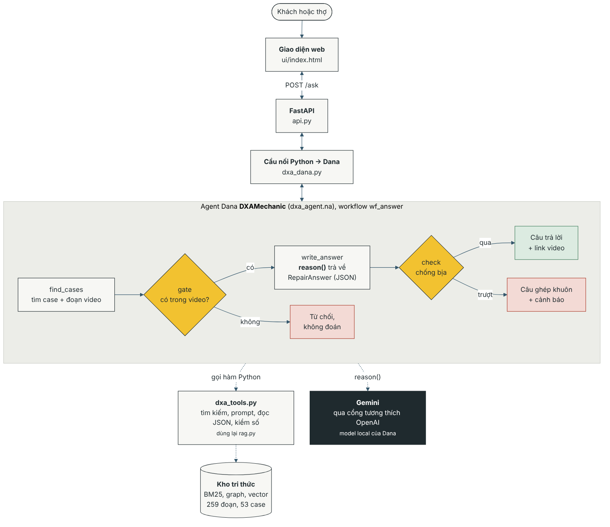

# DXA (bản Dana) – Hỏi thợ sửa xe máy

Bản này giống DXA thường, nhưng phần trả lời câu hỏi do agent viết bằng [Dana](https://github.com/aitomatic/dana) đảm nhận (`dxa_agent.na`).

## Chạy DXA

1. Tải repo về: trên GitHub bấm **Code → Download ZIP**, giải nén.
2. Mở thư mục `dxa-automative-agent_dana`, bấm đúp **`run.bat`**.
3. Lần đầu: bấm **Y** nếu được hỏi cài Python, rồi chờ cài thư viện (5–10 phút).
4. Dán Gemini API key rồi bấm Enter (hoặc bấm Enter để bỏ qua).
5. Trình duyệt tự mở DXA. Gõ câu hỏi, bấm **Hỏi thợ**.

## Luồng chạy khi bấm run.bat

## Các bước dựng DXA

## Kiến trúc DXA (bản Dana)

