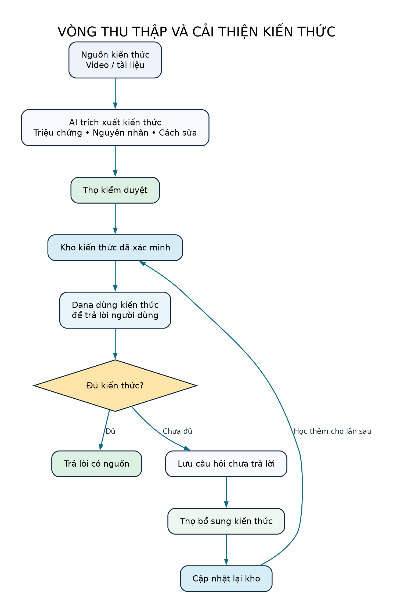

# DXA Dana — AI Agent hỗ trợ chẩn đoán và sửa xe máy

**Hai chế độ:** tra cứu RAG theo workflow cố định (giữ nguyên) và **Agentic Diagnosis** (Planner tự chọn hành động, hỏi tiếp, tra cứu lại, đánh giá và điều chỉnh kế hoạch).

## Kiến trúc 7 tầng của DXA Dana


> **Không có tầng Agentic thứ 8.** Planning, Memory, Replanning và Evaluation thuộc **tầng 3 — Agent Orchestration**. Dana là ngôn ngữ/runtime điều phối; mô hình Gemini hoặc LLM tương thích là tầng suy luận. Không cần fine-tune trọng số để bổ sung vòng điều phối này.

| Tầng | Thành phần đang dùng | Vai trò |
|---|---|---|
| 1 — Presentation | Web UI (`ui/index.html`) | Hỏi đáp và bổ sung kiến thức bởi thợ |
| 2 — API | FastAPI (`api.py`) | `/ask` và `/diagnose`; xác thực thao tác của thợ |
| 3 — Agent Orchestration | Dana (`dxa_agent.na`) + session engine (`diagnostic.py`) | Planning, tool selection, Memory, Replanning, Evaluation; giới hạn số bước |
| 4 — Reasoning | LLM (`reason()`) | Tạo kế hoạch dạng JSON và giải thích có căn cứ; cấu hình hiện tại qua Gemini |
| 5 — Tool Execution | Python (`dxa_tools.py`) | Truy vấn RAG, kiểm tra nguồn/câu trả lời; chỉ thực thi hành động được phép |
| 6 — Retrieval | RAG (`rag.py`), BM25, vector, RRF | Tìm case và phụ đề sửa xe |
| 7 — Data | Qdrant/NumPy, SQLite, JSON, video transcripts | Lưu tri thức, chỉ mục, nguồn và trạng thái phiên chẩn đoán |

## Chạy DXA

1. Tải repo, vào thư mục `dxa-automative-agent_dana`, chạy `run.bat` trên Windows.
2. Cấu hình `GEMINI_API_KEY` trong `.env` để dùng LLM hiện tại. Nếu không có LLM, chế độ **Hỏi thường** vẫn có đường dự phòng offline; **Agentic** sẽ yêu cầu thợ xử lý thay vì giả vờ suy luận.
3. Mở `http://localhost:8000`.
4. Tab **Hỏi**: để tra cứu truyền thống, không bật **Agentic**. Để AI tự hỏi và chọn công cụ, bật **Agentic: chủ động hỏi và điều tra** và tiếp tục trả lời các câu hỏi DXA đưa ra. Bấm **Bắt đầu ca mới** nếu muốn xóa phiên cũ.
5. Tab **Bổ sung kiến thức**: thợ đăng nhập, xem câu chưa trả lời, bổ sung ca sửa chữa, lưu để dựng lại chỉ mục.

**Lưu ý:** Mã thợ demo là `1234`. Khi triển khai thực tế phải đổi `DXA_THO_CODE`, kiểm tra quyền và không đưa dữ liệu nhạy cảm lên mạng.

## Agentic Diagnosis: Planning + Replanning

**Luồng cũ:** `find_cases → gate → write_answer → check` (giữ nguyên ở `/ask`).

**Luồng mới:** `User → Planner (Dana + LLM) → {ask_user | search_rag | answer | handoff} → Memory → Replanning → Evaluator → Kết quả có nguồn`.

Ví dụ: người dùng nhập "Xe không nổ máy" → Agent hỏi "Đề có quay không?" → người dùng trả lời "Đề quay" → Agent chọn lại truy vấn RAG → kiểm chứng trước khi trả lời. Đây là luồng hội thoại nhiều lượt, **không** phải ba agent khác nhau.

### Sử dụng qua API

Bắt đầu phiên:

```bash
curl -X POST http://localhost:8000/diagnose -H "Content-Type: application/json" -d '{"message":"Xe Honda Wave không nổ máy"}'
```

Khi nhận `status: "ask_user"`, gửi câu trả lời cùng `session_id` đã nhận:

```json
{"message":"Đề quay nhưng không nổ","session_id":"<session_id được trả về>"}
```

- `ask_user`: hỏi thêm triệu chứng và chờ người dùng; `answer`: có bằng chứng từ kho; `handoff`: thiếu căn cứ hoặc chạm giới hạn an toàn.
- Giới hạn **4 bước Planner mỗi lượt**, **12 lượt hội thoại**, **12 truy vấn tìm kiếm mỗi phiên**. Không có vòng vô hạn, không tự vận hành xe hoặc tự ra lệnh sửa chữa nguy hiểm.
- Trạng thái hội thoại lưu trong `index/diagnostic_sessions.sqlite3`, tự hết hạn sau 24 giờ. Xóa sớm bằng `DELETE /diagnose/{session_id}`.
- Hành động có allow-list; đầu ra LLM bị kiểm tra; không đủ nguồn thì yêu cầu thợ đánh giá trực tiếp. **Không bảo đảm chẩn đoán đúng** — cần kiểm tra thực tế.
- Có thể thay Gemini bằng mô hình LLM tương thích mà Dana hỗ trợ; phần **embedding Gemini** và đường fallback offline là cấu hình độc lập, không tự chuyển theo LLM.

### Test

```bash
python dxa.py build
python test_dana.py
python test_agentic.py
python test_expert.py
```

`test_agentic.py` kiểm tra hội thoại hai lượt, lưu session, thay đổi kế hoạch sau dữ kiện mới, nguồn bằng chứng, giới hạn vòng lặp và hành động không hợp lệ bằng **LLM giả**; không chứng minh chất lượng chẩn đoán thực tế. Cần chạy thêm với model thật và các tình huống thợ đã xác minh trước khi sử dụng ngoài demo.

## Nạp kiến thức sửa xe

`Video → Phụ đề → Trích xuất case → Kiểm chứng → Thợ duyệt → Kho tri thức → RAG → Agent`. Câu chưa trả lời được được ghi lại để thợ bổ sung, không tự bịa thông tin.



## Các sơ đồ bổ sung

**Luồng khởi động:** 

**Các bước dựng DXA:** 

**Sơ đồ kiến trúc phiên bản cũ:** 

## Phạm vi hiện tại

Đây là **AI Agent demo trợ giúp thợ**, không phải hệ thống chẩn đoán xác thực qua thiết bị OBD/ECU. Phần tự lập kế hoạch thực hiện ở tầng điều phối hiện tại; không yêu cầu huấn luyện lại trọng số mô hình. Triển khai production cần bảo mật phiên, xác thực đa người dùng, kiểm thử an toàn hướng dẫn sửa chữa và đánh giá định lượng với dữ liệu thực.
