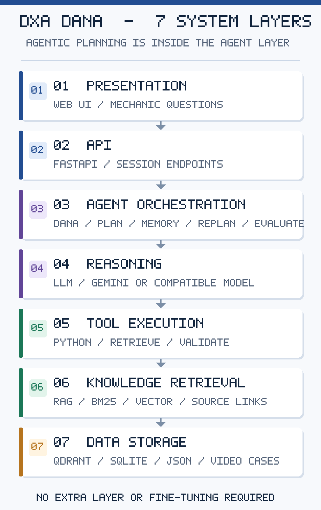
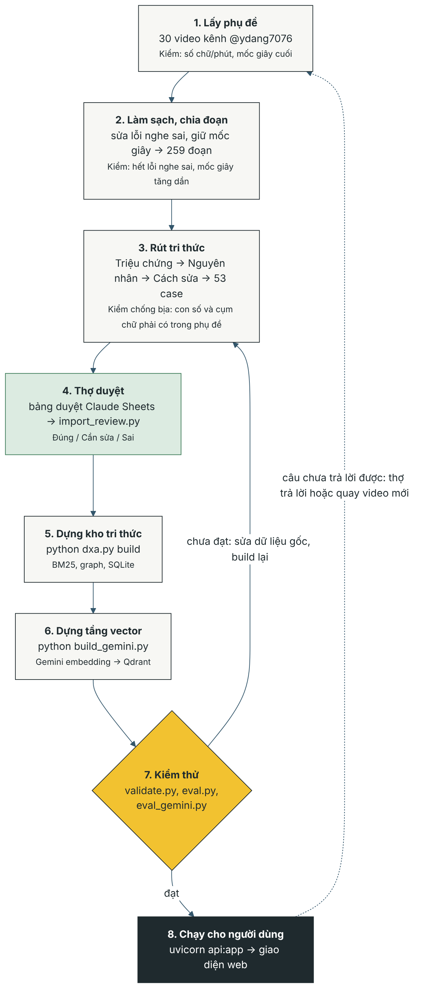
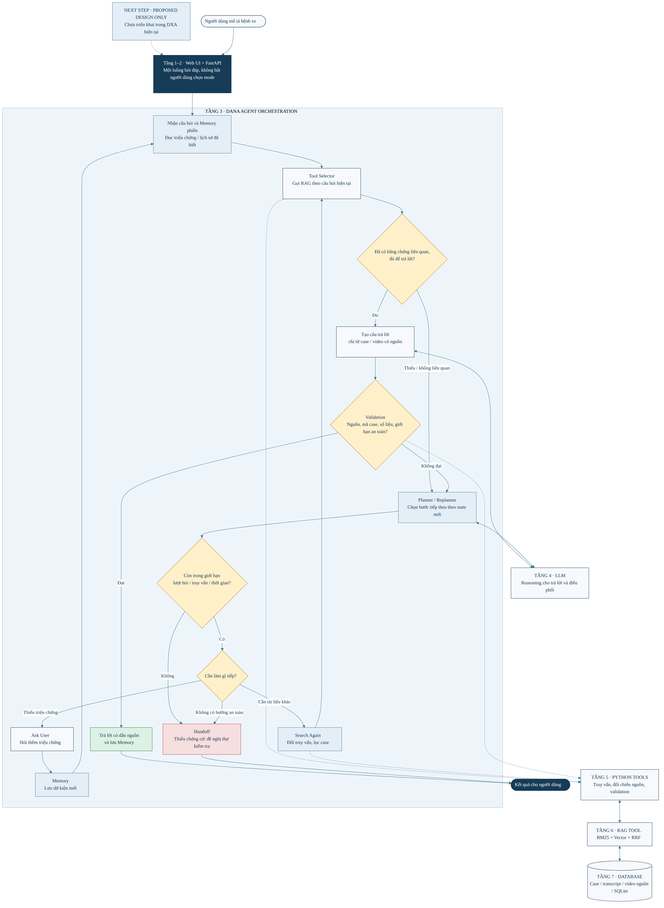
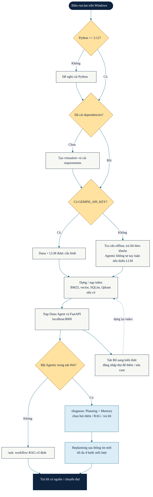
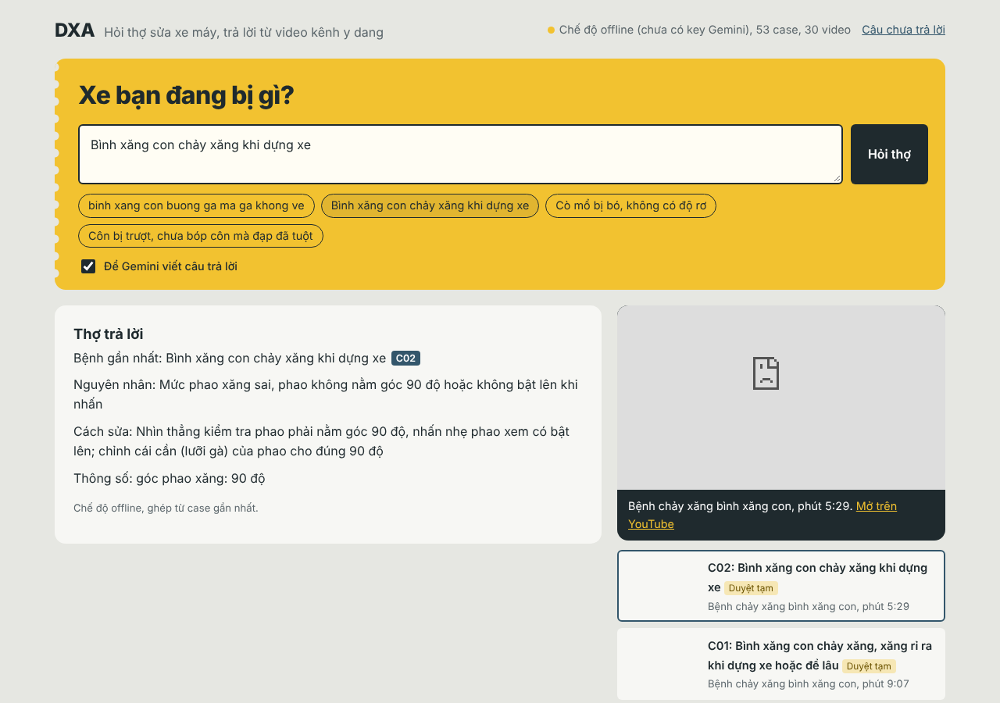

# DXA Dana — AI Agent hỗ trợ chẩn đoán và sửa xe máy

**Hai chế độ:** tra cứu RAG theo workflow cố định (giữ nguyên) và **Agentic Diagnosis** (Planner tự chọn hành động, hỏi tiếp, tra cứu lại, đánh giá và điều chỉnh kế hoạch).

## Kiến trúc 7 tầng của DXA Dana



**Luồng xây dựng tri thức và chẩn đoán Agentic (đã cập nhật):**



**Sơ đồ kỹ thuật đầy đủ:**


> **Không có tầng Agentic thứ 8.** Planning, Memory, Replanning và Evaluation thuộc **tầng 3 — Agent Orchestration**. Dana là ngôn ngữ/runtime điều phối; mô hình Gemini hoặc LLM tương thích là tầng suy luận. Không cần fine-tune trọng số để bổ sung vòng điều phối này.

| Tầng | Thành phần đang dùng | Vai trò |
|---|---|---|
| 1 — Presentation | Web UI (`ui/index.html`) | Hỏi đáp và bổ sung kiến thức bởi thợ |
| 2 — API | FastAPI (`api.py`) | `/ask` và `/diagnose`; xác thực thao tác của thợ |
| 3 — Agent Orchestration | Dana (`dxa_agent.na`) + session engine (`diagnostic.py`) | Planning, tool selection, Memory, Replanning, Evaluation; giới hạn số bước |
| 4 — Reasoning | LLM (`reason()`) | Tạo kế hoạch dạng JSON và giải thích có căn cứ; cấu hình hiện tại qua Gemini |
| 5 — Tool Execution | Python (`dxa_tools.py`) | Truy vấn RAG, kiểm tra nguồn/câu trả lời; chỉ thực thi hành động được phép |
| 6 — Retrieval | RAG (`rag.py`), BM25, vector, RRF | Tìm case và phụ đề sửa xe |
| 7 — Data | Qdrant/NumPy, SQLite, JSON, video transcripts | Lưu tri thức, chỉ mục, nguồn và trạng thái phiên chẩn đoán |

## NOTE FOR NEXT STEP — Hợp nhất RAG + Agentic (CHƯA TRIỂN KHAI)

**Trạng thái: chỉ là đề xuất luồng hợp nhất — CHƯA TRIỂN KHAI Planning/Replanning chung.** Các chỉnh sửa Giai đoạn 1 bên dưới chỉ cải thiện hiệu năng đường RAG offline và trải nghiệm timeout; không thay kiến trúc hai chế độ hiện tại.



**Mục tiêu:** Một ô hỏi đáp duy nhất; người dùng không phải biết hoặc chọn giữa “RAG” và “Agentic”. **Dana (tầng 3)** sẽ điều phối toàn bộ; **RAG vẫn ở tầng 6** và được gọi như một tool, không tạo tầng thứ 8 hay thêm Agent độc lập.

**Cơ chế đề xuất:**

1. **RAG trước khi cần:** câu hỏi đủ rõ → truy xuất BM25 + vector và case/video liên quan; đọc Memory phiên hiện có nếu có. Không nhất thiết gọi Planner cho mỗi câu hỏi đơn giản.
2. **Evidence Gate (cổng kiểm chứng bằng chứng):** đủ tài liệu **liên quan trực tiếp** để trả lời thì tạo câu trả lời có nguồn, sau đó bắt buộc chạy **Validation** (kiểm mã case, dẫn nguồn, số liệu, an toàn). **Không được bỏ qua Validation**, dù RAG tìm thấy tài liệu.
3. **Thiếu triệu chứng:** gọi **Planner** chọn câu hỏi bổ sung → nhận câu trả lời người dùng → **Memory** lưu dữ kiện → tìm RAG lại.
4. **Thiếu hoặc lệch tài liệu, Validation trượt:** gọi **Replanner** xem bằng chứng và lịch sử, đổi truy vấn RAG hoặc hỏi thêm; rồi kiểm tra lại. Replanning là gọi lại logic ra quyết định với state mới, **không phải một model/Agent mới**.
5. **Không có căn cứ hoặc quá giới hạn:** **handoff** cho thợ / báo không đủ dữ liệu, không suy diễn nguyên nhân. Giữ giới hạn số bước, số truy vấn và thời gian.

| Điều kiện | Xử lý đề xuất |
|---|---|
| Câu hỏi rõ + RAG đủ bằng chứng | Tạo câu trả lời → Validation → trả lời kèm nguồn |
| Chưa biết triệu chứng quan trọng | Planner hỏi thêm → Memory → RAG |
| RAG thiếu/sai nguồn hoặc Validation không đạt | Replanner → tìm lại / hỏi thêm → Validation |
| Không tìm được chứng cứ phù hợp sau số lượt cho phép | Handoff; không đoán bừa |
| Không có LLM hoạt động | Tra cứu và kiểm chứng offline khi có thể; nêu rõ giới hạn, không giả lập Planning |

**Phân tách hiện tại và tương lai:** Bản DXA **đang chạy** vẫn có hai đường `POST /ask` (workflow cố định) và `POST /diagnose` (Agentic nhiều lượt) và checkbox trên UI. Việc hợp nhất chúng thành một trải nghiệm **chưa được code**; sơ đồ bên trên chỉ là **note cho lần phát triển tiếp theo**.

**Tiêu chí triển khai ở bước sau:** bảo toàn khả năng tra cứu offline, đo latency/chi phí so với luồng cũ, bổ sung test tình huống “RAG đủ / thiếu triệu chứng / nguồn sai / Validation trượt / quá giới hạn”, kiểm tra lại hành vi với LLM thật và thợ sửa xe. Giữ các endpoint cũ tương thích cho đến khi migration được kiểm chứng.

Nguồn có thể chỉnh sửa: [docs/next-step-unified-flow.mmd](docs/next-step-unified-flow.mmd). PNG tự sinh bằng workflow tài liệu; không phản ánh thay đổi runtime.

---

## Giai đoạn 1 — Sửa hiệu năng và trải nghiệm (đã đưa vào code)

**Mục tiêu:** Câu hỏi nào cũng được gửi vào RAG trước khi hệ thống quyết định có nguồn phù hợp hay cần thợ bổ sung. Không giới hạn quyền đặt câu hỏi. Nếu không đủ bằng chứng sau khi tìm, DXA ghi nhận để thợ xem xét; không nói “đang cập nhật” khi chưa có việc cập nhật thực tế.

- **Offline bypass:** `POST /ask` không có Gemini key sẽ gọi `rag.answer(..., use_llm=False)` trực tiếp, bỏ qua khởi tạo/gọi Dana dù checkbox LLM được gửi là `true`. Không thay đổi `POST /diagnose` (Agentic).
- **Khởi động:** nạp `state.pkl` và từ điển chuẩn hóa câu hỏi trước khi mở API; không cần nạp Dana trong môi trường offline.
- **Đo hiệu năng:** log `[DXA perf]` báo `index_ms`, `normalize_ms`, `bm25_ms`, `vector_ms`, `rank_gate_ms`, `retrieval_ms`, `total_ms` và `other_ms`. `POST /ask` trả thêm `timings_ms`.
- **UI:** offline tự bỏ tick và vô hiệu hóa Gemini; hiển thị lỗi và mở lại nút hỏi nếu quá `12s` (offline), `60s` (LLM), hoặc `90s` (Agentic). Thời gian này là *timeout phía trình duyệt*, không hủy chắc chắn tác vụ đồng bộ đang chạy trong backend.
- **Cache:** kho tri thức được giữ trong RAM giữa các câu hỏi; trang chủ gửi `Cache-Control: no-store` để không thấy checkbox UI cũ.
- **Test:** `python test_perf.py` gửi **10 câu hỏi RAG thật liên tiếp**, kiểm tra đường offline không gọi Dana, báo median và max. Mục tiêu vận hành offline sau warm-up là ~1–3 giây/câu, nhưng chưa coi đó là kết quả đo trên PC của người dùng.

**Vẫn còn:** không có Gemini key thì DXA chỉ trả lời bằng dữ liệu đã có hoặc báo chưa đủ bằng chứng; quyền đặt câu hỏi không đồng nghĩa LLM có thể trả lời mọi lĩnh vực. Việc cho LLM trả lời ngoài kho theo mức độ tin cậy và việc hợp nhất Agentic vẫn dành cho bước phát triển tiếp theo.

---

## Chạy DXA

1. Tải repo, vào thư mục `dxa-automative-agent_dana`, chạy `run.bat` trên Windows.
2. Cấu hình `GEMINI_API_KEY` trong `.env` để dùng LLM hiện tại. Nếu không có LLM, chế độ **Hỏi thường** vẫn có đường dự phòng offline; **Agentic** sẽ yêu cầu thợ xử lý thay vì giả vờ suy luận.
3. Mở `http://localhost:8000`.
4. Tab **Hỏi**: để tra cứu truyền thống, không bật **Agentic**. Để AI tự hỏi và chọn công cụ, bật **Agentic: chủ động hỏi và điều tra** và tiếp tục trả lời các câu hỏi DXA đưa ra. Bấm **Bắt đầu ca mới** nếu muốn xóa phiên cũ.
5. Tab **Bổ sung kiến thức**: thợ đăng nhập, xem câu chưa trả lời, bổ sung ca sửa chữa, lưu để dựng lại chỉ mục.

**Lưu ý:** Mã thợ demo là `1234`. Khi triển khai thực tế phải đổi `DXA_THO_CODE`, kiểm tra quyền và không đưa dữ liệu nhạy cảm lên mạng.

## Agentic Diagnosis: Planning + Replanning

**Luồng cũ:** `find_cases → gate → write_answer → check` (giữ nguyên ở `/ask`).

**Luồng mới:** `User → Planner (Dana + LLM) → {ask_user | search_rag | answer | handoff} → Memory → Replanning → Evaluator → Kết quả có nguồn`.

Ví dụ: người dùng nhập "Xe không nổ máy" → Agent hỏi "Đề có quay không?" → người dùng trả lời "Đề quay" → Agent chọn lại truy vấn RAG → kiểm chứng trước khi trả lời. Đây là luồng hội thoại nhiều lượt, **không** phải ba agent khác nhau.

### Sử dụng qua API

Bắt đầu phiên:

```bash
curl -X POST http://localhost:8000/diagnose -H "Content-Type: application/json" -d '{"message":"Xe Honda Wave không nổ máy"}'
```

Khi nhận `status: "ask_user"`, gửi câu trả lời cùng `session_id` đã nhận:

```json
{"message":"Đề quay nhưng không nổ","session_id":"<session_id được trả về>"}
```

- `ask_user`: hỏi thêm triệu chứng và chờ người dùng; `answer`: có bằng chứng từ kho; `handoff`: thiếu căn cứ hoặc chạm giới hạn an toàn.
- Giới hạn **4 bước Planner mỗi lượt**, **12 lượt hội thoại**, **12 truy vấn tìm kiếm mỗi phiên**. Không có vòng vô hạn, không tự vận hành xe hoặc tự ra lệnh sửa chữa nguy hiểm.
- Trạng thái hội thoại lưu trong `index/diagnostic_sessions.sqlite3`, tự hết hạn sau 24 giờ. Xóa sớm bằng `DELETE /diagnose/{session_id}`.
- Hành động có allow-list; đầu ra LLM bị kiểm tra; không đủ nguồn thì yêu cầu thợ đánh giá trực tiếp. **Không bảo đảm chẩn đoán đúng** — cần kiểm tra thực tế.
- Có thể thay Gemini bằng mô hình LLM tương thích mà Dana hỗ trợ; phần **embedding Gemini** và đường fallback offline là cấu hình độc lập, không tự chuyển theo LLM.

### Test

```bash
python dxa.py build
python test_dana.py
python test_agentic.py
python test_expert.py
```

`test_agentic.py` kiểm tra hội thoại hai lượt, lưu session, thay đổi kế hoạch sau dữ kiện mới, nguồn bằng chứng, giới hạn vòng lặp và hành động không hợp lệ bằng **LLM giả**; không chứng minh chất lượng chẩn đoán thực tế. Cần chạy thêm với model thật và các tình huống thợ đã xác minh trước khi sử dụng ngoài demo.

## Nạp kiến thức sửa xe

`Video → Phụ đề → Trích xuất case → Kiểm chứng → Thợ duyệt → Kho tri thức → RAG → Agent`. Câu chưa trả lời được được ghi lại để thợ bổ sung, không tự bịa thông tin.


## Các sơ đồ bổ sung

**Luồng khởi động, lựa chọn Agentic và xử lý offline:**



**Pipeline tri thức, hai chế độ Agent và feedback thợ:**


**Giao diện DXA:**



Tài liệu kỹ thuật được đồng bộ với các PNG: [KY-THUAT.md](docs/KY-THUAT.md), [chi-tiet.md](docs/chi-tiet.md). Nguồn sơ đồ: `docs/flow.mmd`, `docs/architecture.mmd`, `docs/run-flow.mmd`, `docs/pipeline.dot`; workflow [dxa-docs-render.yml](../.github/workflows/dxa-docs-render.yml) tái tạo ảnh từ nguồn. Các bài test CI không thay thế kiểm thử chẩn đoán bằng LLM thật.

## Phạm vi hiện tại

Đây là **AI Agent demo trợ giúp thợ**, không phải hệ thống chẩn đoán xác thực qua thiết bị OBD/ECU. Phần tự lập kế hoạch thực hiện ở tầng điều phối hiện tại; không yêu cầu huấn luyện lại trọng số mô hình. Triển khai production cần bảo mật phiên, xác thực đa người dùng, kiểm thử an toàn hướng dẫn sửa chữa và đánh giá định lượng với dữ liệu thực.
