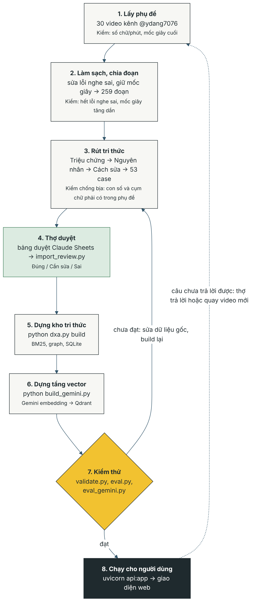
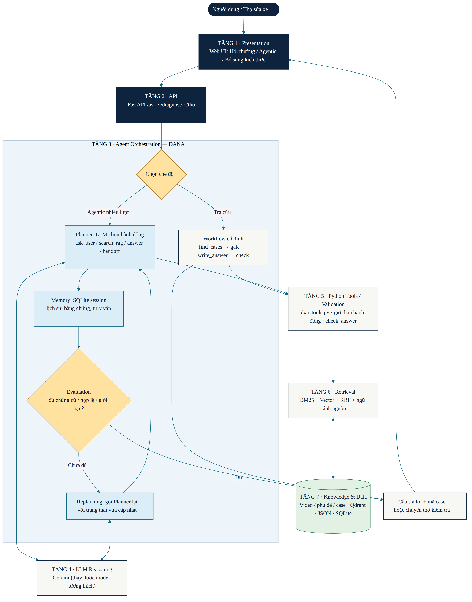
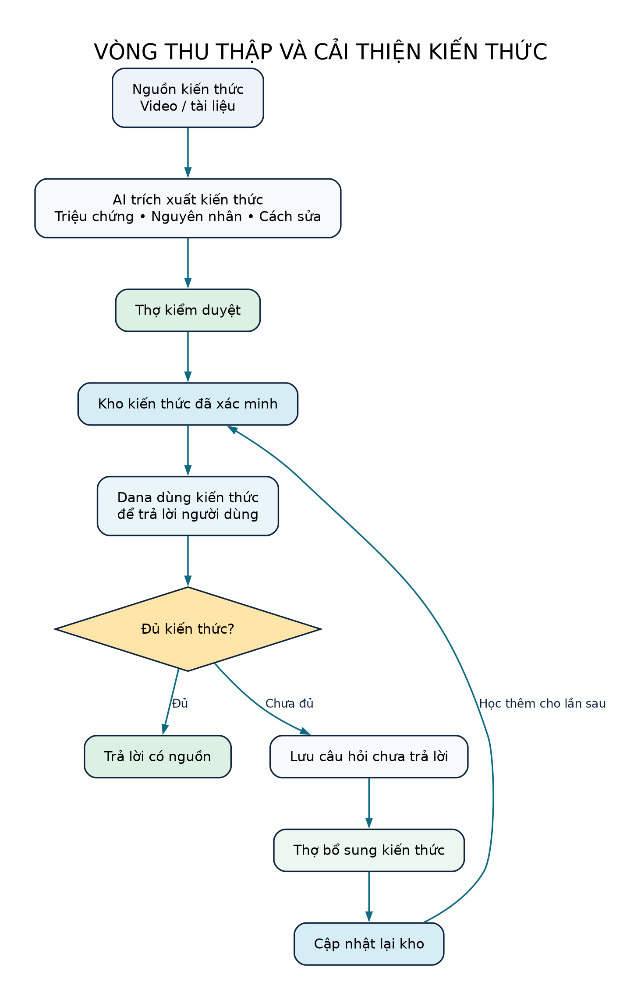
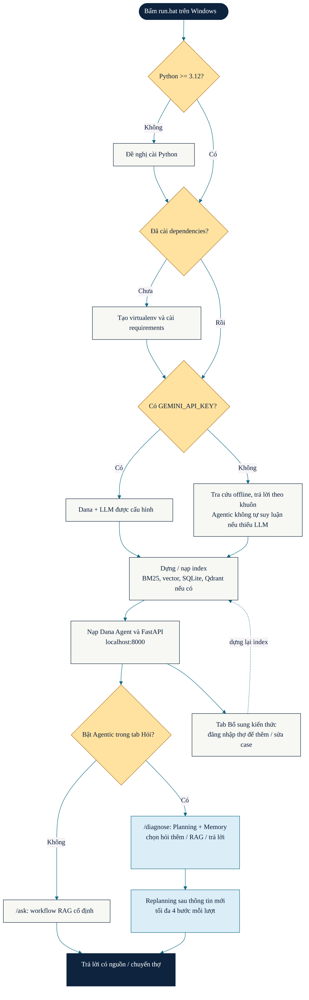
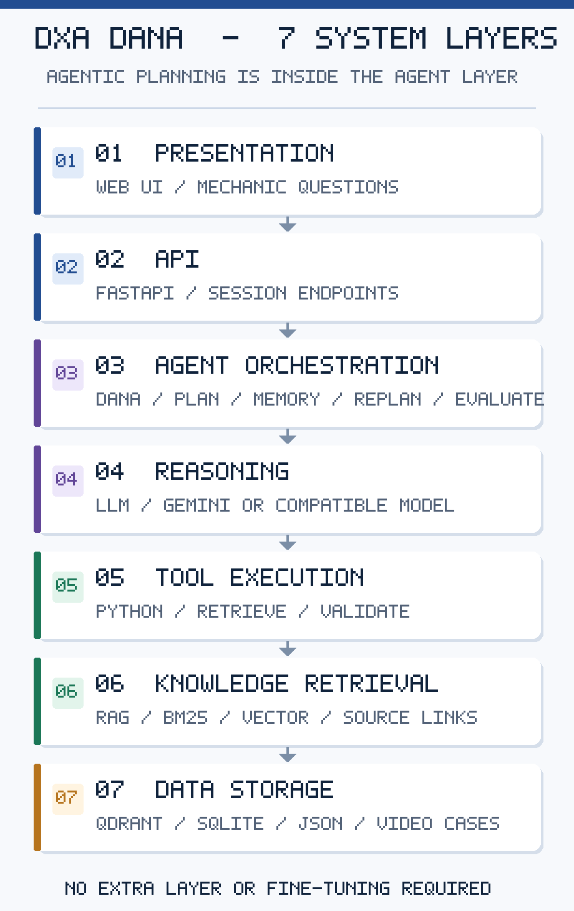

# DXA Dana — Tài liệu kỹ thuật (Agentic AI)

> Cập nhật 23/11/2026 · DXA có **hai chế độ**: tra cứu RAG (workflow cố định) và chẩn đoán nhiều lượt **Agentic** (Self-Planning + Replanning). Đây vẫn là **một Dana Agent**, không phải một hệ thống nhiều Agent. Không cần fine-tune trọng số để điều phối.

Xem [README](../README.md) để chạy nhanh. Tài liệu chi tiết dữ liệu và các hạn chế: [chi-tiet.md](chi-tiet.md).

## Sơ đồ đồng bộ với bản mới

**Các bước dựng và hai luồng hoạt động:**



**Kiến trúc hệ thống, Dana và các công cụ:**



**Pipeline tri thức, trao đổi với thợ và vòng cải tiến:**



**Khởi động ứng dụng trên Windows:**



**Bảy tầng tổng thể (Agentic nằm trong tầng 3, không thêm tầng 8):**



## 7 tầng phần mềm

| Tầng | Thành phần | Vai trò |
|---|---|---|
| 1 — Presentation | `ui/index.html` | Người dùng hỏi, chọn Agentic, trả lời câu hỏi bổ sung; thợ nhập kiến thức |
| 2 — API | `api.py` + FastAPI | `/ask`, `/diagnose`, `/health`, `/tho/*` |
| 3 — Agent Orchestration | `dxa_agent.na`, `diagnostic.py` | Dana điều phối; Planner, Tool Selector, Memory và Replanning |
| 4 — Reasoning | Dana `reason()` + LLM | Mô hình chọn hành động và tạo lời giải thích từ nguồn |
| 5 — Tool Execution / Validation | `dxa_tools.py` | Công cụ truy vấn, prompt JSON, kiểm tra không bịa và danh sách hành động cho phép |
| 6 — Retrieval | `rag.py` | BM25 + tìm kiếm vector + RRF, lấy case và nguồn thời gian |
| 7 — Data | `data/`, `index/`, SQLite, Qdrant/NumPy | Kho case, phụ đề, vector, lịch sử phiên chẩn đoán |

**Phân biệt:** Dana là ngôn ngữ/runtime cho Agent; Gemini là LLM có thể thay thế nếu model tương thích. Chúng không phải hai Agent khác nhau.

## Các file Agentic mới / đã sửa

| File | Chức năng |
|---|---|
| `dxa_agent.na` | Giữ `wf_answer`; thêm `plan_diagnostic()` và `answer_diagnostic()` |
| `dxa_dana.py` | Gọi các hàm Dana từ Python; cấu hình model; fallback cho `/ask` |
| `dxa_tools.py` | `planning_prompt()`, `parse_plan()`, `retrieve()`, kiểm chứng câu trả lời |
| `diagnostic.py` | Vòng quyết định nhiều lượt, cập nhật Memory, giới hạn hành động và session |
| `api.py` | `/diagnose` cho Agentic, `DELETE /diagnose/{session_id}` |
| `ui/index.html` | Checkbox Agentic; hỏi tiếp trong cùng ca và nút Bắt đầu ca mới |
| `test_agentic.py` | Test ngoại tuyến Planner/Replanning/Memory/giới hạn vòng lặp |
| `test_dana.py`, `test_expert.py` | Regression của Dana/RAG và quyền nhập tri thức |
| `docs/*.mmd`, `docs/pipeline.dot` | Source của PNG; phải render lại sau khi sửa |

## Cơ chế hai chế độ

### 1) Tra cứu truyền thống — POST /ask

`find_cases → gate → write_answer → check`. Truy vấn BM25/vector tìm tài liệu, qua cổng từ chối, LLM viết câu trả lời, bộ kiểm không cho bịa số hoặc mã case. Không có LLM thì fallback ghép khuôn. **Luồng này giữ nguyên để tương thích ngược.**

### 2) Chẩn đoán Agentic — POST /diagnose

`Người dùng → Planner (Dana + LLM) → chọn hành động → cập nhật Memory → Planner đọc lại state (Replanning) → câu hỏi / RAG / trả lời / chuyển thợ`.

Bốn hành động được phép:

- `ask_user`: đặt **một câu hỏi** về triệu chứng rồi tạm dừng chờ người dùng;
- `search_rag`: chọn lại từ khóa phù hợp và gọi tool truy xuất case;
- `answer`: chỉ trả lời khi có case và vượt kiểm tra nguồn;
- `handoff`: dừng lại, yêu cầu thợ kiểm tra trực tiếp khi thiếu căn cứ.

**Replanning không phải một model mới hay một tầng thứ tám**. Hàm Planner được gọi lại sau khi cập nhật lịch sử, công cụ và bằng chứng. Các thành phần Evaluation hiện là các điều kiện kiểm chứng và giới hạn trong `diagnostic.py`, không phải một mô hình Evaluator huấn luyện riêng.

Memory lưu trong `index/diagnostic_sessions.sqlite3` (SQLite). Tối đa **4 quyết định mỗi lượt, 12 lượt hỏi đáp, 12 lượt truy vấn RAG mỗi phiên**, phiên hết hạn sau khoảng 24 giờ. Session ID mang tính ngẫu nhiên, không phải hệ thống đăng nhập cho production.

Ví dụ:
1. Người dùng: “Xe Honda Wave không nổ máy”.
2. Planner: `ask_user` — “Khi bấm đề, động cơ có quay không?”.
3. Người dùng trả lời “Đề quay”.
4. Memory lưu triệu chứng mới; Planner có thể `search_rag` với truy vấn cập nhật.
5. Nếu chưa đủ chứng cứ, hỏi tiếp hoặc `handoff`; nếu đủ, trả lời kèm nguồn.

**Giới hạn quan trọng:** Planner chỉ có thể dùng các tool được phép; nó không tự đo cảm biến, thực hiện kiểm tra vật lý hay bảo đảm chẩn đoán. Chưa kiểm thử chất lượng chẩn đoán với Gemini thật trên bộ ca thực tế độc lập.

## API mới và cũ

| Endpoint | Yêu cầu / vai trò |
|---|---|
| `POST /ask` | `{"question":"...", "use_llm":true}` — RAG truyền thống |
| `POST /diagnose` | `{"message":"Xe không nổ máy"}` — bắt đầu ca |
| `POST /diagnose` | `{"message":"Đề quay", "session_id":"..."}` — trả lời câu hỏi Planner |
| `DELETE /diagnose/{session_id}` | Kết thúc và xóa phiên chẩn đoán |
| `GET /health` | Số video, case, mode tìm kiếm |
| `GET /cases/{id}` | Chi tiết một case và link video |
| `POST /tho/login`, `POST /tho/logout`, `GET /tho/me` | Đăng nhập và kiểm tra quyền thợ |
| `GET /unanswered`, `GET /tho/cases`, `POST /tho/cases`, `DELETE /tho/cases/{id}` | Xem / cập nhật tri thức — bắt buộc có token thợ |

**Không tự chia sẻ session ID với người lạ.** API Agentic là bản demo; trước khi triển khai Internet cần xác thực người dùng, giới hạn tốc độ, chống lạm dụng, logging không lộ bí mật.

## Chạy từ mã nguồn

Trên Windows, tải/pull bản GitHub mới nhất về `dxa-automative-agent_dana`, chạy `run.bat`; hoặc:

```powershell
python -m pip install -r requirements.txt
python dxa.py build
python test_agentic.py
python test_dana.py
python test_expert.py
python -m uvicorn api:app --port 8000
```

Mở `http://localhost:8000`. Đặt `GEMINI_API_KEY=...` trong `.env` nếu muốn Planner dùng Gemini; không đưa key vào GitHub. `python build_gemini.py` chỉ cần khi muốn dựng lại embedding Gemini / Qdrant.

**Không có LLM thật:** RAG cổ điển vẫn dùng được ở chế độ offline, còn Agentic trả lời `handoff` thay vì giả vờ có suy luận.

### Kiểm thử và trạng thái

- `python validate.py` và `python eval.py`: kiểm thử kho dữ liệu / tìm kiếm offline.
- `python test_agentic.py`: bài test phụ thuộc LLM giả, xác nhận luồng và các giới hạn, **không phải kiểm chứng y khoa/cơ khí hoặc chất lượng LLM thật**.
- `python test_dana.py`: agent Dana ở chế độ mock/offline.
- `python test_expert.py`: đăng nhập, phân quyền, lưu và gỡ case.
- CI ở `.github/workflows/dxa-dana.yml` chạy cả Linux và Windows. `dana deploy` riêng còn lỗi `SandboxFunction.__call__() got multiple values for argument 'context'` ở Dana 0.6.0.3.post3; dùng FastAPI `api.py` thay cho REST `dana deploy /solve`.
- `GEMINI_API_KEY` GitHub secret chưa được xác nhận trong test vừa xem; **không tuyên bố bản Agentic với Gemini thật đã đạt**.

## Nguồn tri thức và cơ chế thợ duyệt

Nguồn dữ liệu lịch sử: 30 video, 259 chunk, 53 case (số lượng có thể tăng khi thợ thêm case). Dòng nạp dữ liệu:

`Video → phụ đề → làm sạch → rút ca → kiểm chống bịa → thợ duyệt → build BM25 + SQLite + vector → tra cứu`.

Case do thợ nhập nằm ở `data/knowledge_expert.json`, mã `T01`, `T02`...; case bị gỡ sẽ có `status: rejected`, giữ lịch sử ở `data/knowledge_expert_history.jsonl`. Thợ duyệt các case cũ phần lớn mới ở mức **duyệt tạm**, cần kiểm tra thực tế.

## Đổi model

`DXA_LLM_MODEL` đổi model Gemini đang cấu hình. `DXA_EMBED_MODEL` và `DXA_EMBED_DIM` điều khiển tầng embedding độc lập. Có thể thay model suy luận bằng backend tương thích API Dana, nhưng cần kiểm tra `dxa_dana.py` và cấu hình provider; **không mặc định mọi model tự chạy được**.

## Cập nhật hình ảnh trong thư mục docs

Mỗi sơ đồ phải có cặp source ảnh: `architecture.mmd → architecture.png`, `flow.mmd → flow.png`, `run-flow.mmd → run-flow.png`, `pipeline.dot → pipeline.png`. `ui.png` là ảnh chụp giao diện mới; `dxa_7_layers.png` là sơ đồ 7 tầng. Không sửa PNG thủ công rồi để source cũ lệch phiên bản.
