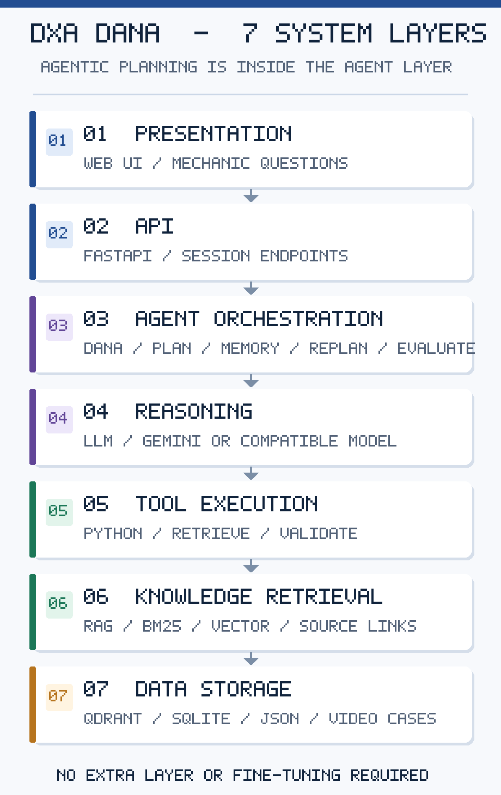
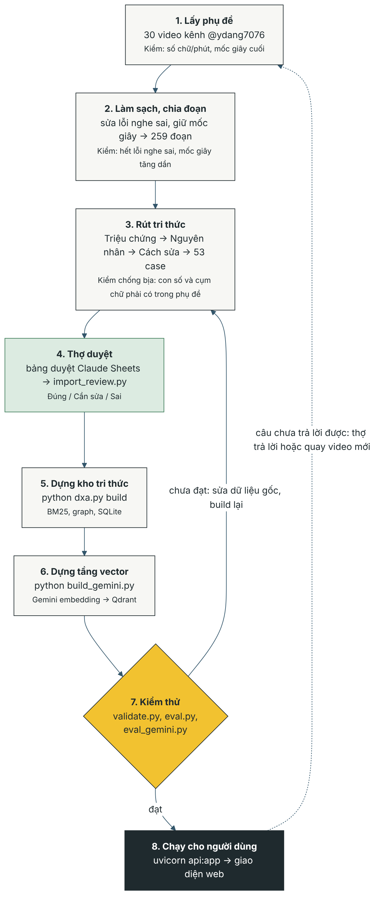
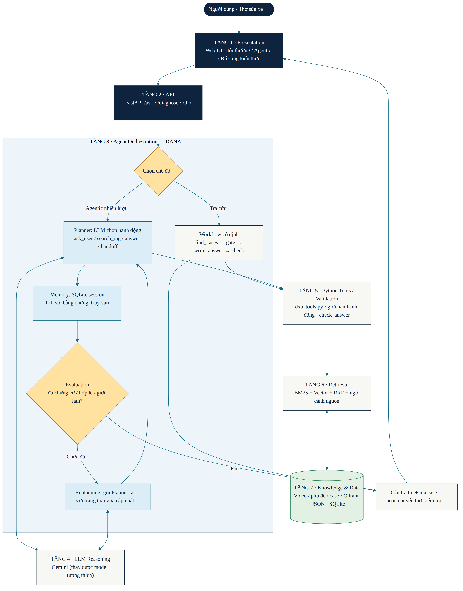

# DXA Dana — Dữ liệu, đánh giá và giới hạn kỹ thuật

*Cập nhật 23/11/2026 cho DXA với Agentic Planning / Replanning. Tài liệu triển khai: [KY-THUAT.md](KY-THUAT.md).*

## Phạm vi và dữ liệu đầu vào

DXA khai thác video sửa xe máy ở kênh [y dang](https://www.youtube.com/@ydang7076), kết hợp kiến thức do thợ nhập.

| Hạng mục | Đường dữ liệu gốc |
|---|---|
| Video nguồn | 30 (27 video có nội dung, 3 bỏ qua) |
| Chunk transcript đã làm sạch | 259 |
| Case chuẩn hóa | 53 case ban đầu |
| Graph quan hệ | 369 node, 469 cạnh trong bản kiểm 53 case |
| Hệ thống kỹ thuật | Nhiên liệu, động cơ, điện, khung sườn, truyền động, thân vỏ và các công cụ liên quan |

Các con số là **baseline lúc dựng kho**, không phải số đếm vĩnh viễn: `/health` trả trạng thái hiện tại, thêm case `T01`... sẽ làm tăng số lượng.

## Kiến trúc đã cập nhật

`Dana Orchestration` là **tầng 3**. Planner, Memory và vòng Replanning là các tính năng bên trong tầng đó, sử dụng LLM suy luận ở **tầng 4**. Không tạo thêm tầng thứ 8, không thêm multi-agent.

### Chế độ A — Tra cứu cố định

`/ask` thực hiện `find_cases → gate → write_answer → check`. Tìm case bằng BM25 + vector rồi gộp kết quả; kiểm tra câu trả lời, không tự kết luận ngoài chứng cứ. Không có key thì dùng TF-IDF + khuôn.

### Chế độ B — Agentic Diagnosis

`/diagnose` nhận `message` và tùy chọn `session_id`; Planner quyết định `ask_user`, `search_rag`, `answer` hoặc `handoff`. Mỗi hành động được kiểm soát trước khi chạy. Memory trong SQLite lưu lịch sử triệu chứng, query và bằng chứng, để Planner **lập kế hoạch lại trên state cập nhật**. Nếu không đủ bằng chứng hoặc quá giới hạn thì `handoff`.

Giới hạn hiện tại: 4 quyết định/lượt, 12 lượt/phiên, 12 truy vấn tìm kiếm/phiên, TTL 24 giờ. Đây là triển khai **Agentic có kiểm soát**, không phải AI được tự do vận hành thiết bị.

## Kiểm thử đã có

| Nhóm kiểm | Cách chạy | Điều được kiểm |
|---|---|---|
| Dữ liệu và nguồn | `python validate.py` | Phụ đề, trích xuất case, graph/SQL, chất lượng baseline |
| Truy xuất offline | `python eval.py` | Tìm đúng case và từ chối câu ngoài phạm vi |
| Dana | `python test_dana.py` | Workflow cũ hoạt động với mock/offline |
| Agentic (mới) | `python test_agentic.py` | Memory nhiều lượt; planner hỏi rồi truy xuất; xử lý thiếu nguồn; vòng lặp; ID không hợp lệ |
| Thợ | `python test_expert.py` | Token, cập nhật/gỡ case, rebuild |
| Gemini thật | `python eval_gemini.py --llm` và kịch bản chẩn đoán thực tế | **Chưa đủ bằng chứng kiểm định chất lượng Agentic** |

GitHub Actions lần kiểm thử bản Agentic ngày 23/11/2026 đã có **5/5 test Agentic offline đạt**, test Dana Linux/Windows đạt. Không được diễn giải kết quả mock thành “chẩn đoán xe thật đã chính xác”.

### Kết quả đánh giá truy xuất cũ (baseline)

Bộ đánh giá tự xây: đúng case ở top 1 **38/39**, top 3 **39/39** và từ chối **8/8** câu ngoài phạm vi trong bản offline tại thời điểm kiểm trước. Đây không phải tập dữ liệu độc lập; có nguy cơ **overfitting (khớp quá mức vào đề tự viết)** và cần bộ 30–50 câu từ khách thật chưa dùng để chỉnh ngưỡng.

### Rủi ro chuyên môn cần thợ kiểm tra

- **C23:** thông số nâng cam chưa chắc đơn vị.
- **C25:** nội dung đấu rơ-le ở hình vẽ có thể không nằm trong phụ đề.
- **C26, C38:** các trường hợp sườn / canh bánh phụ thuộc hình.
- **C52:** số đo trong video có đơn vị nghe chưa rõ.
- **C51:** video liên quan ECU nhưng không phải mọi nội dung đều là hướng dẫn kỹ thuật.

Các case được đánh dấu `reviewed` trong lần duyệt tạm **không đồng nghĩa đã được thợ độc lập xác minh hoàn chỉnh**.

## Các lỗi và hạn chế đã biết

1. Phần hình ảnh không có transcript có thể bị mất thông tin.
2. `/ask` offline và `/diagnose` Agentic là hai hành vi khác nhau: không có LLM, Agentic không giả lập tự lập kế hoạch.
3. `dana deploy dxa_agent.na` với Dana 0.6.0.3.post3 có lỗi tham số `context` ở `/solve`. DXA hiện chạy `uvicorn api:app` thay thế.
4. Planner dùng tool có giới hạn và có check nguồn, nhưng chưa có đánh giá an toàn hướng dẫn sửa xe trên một tập kiểm độc lập với model thật.
5. Session SQLite chưa có auth/ACL đa người dùng; dùng trên Internet cần tăng cường bảo mật và phân quyền.
6. **Không cần fine-tune** cho vòng Planning/Replanning. Fine-tune chỉ nên cân nhắc sau khi có lỗi ổn định đã đo được và dữ liệu nhãn đáng tin.

## Nạp / sửa kiến thức

Thợ dùng tab **Bổ sung kiến thức**, có xác thực máy chủ; `expert.py` lưu case ở `data/knowledge_expert.json`, đánh `rejected` khi gỡ (có lịch sử), rebuild chỉ mục rồi thử lại câu hỏi. Xem [sơ đồ pipeline](pipeline.png).

## Việc tiếp theo để đủ chuẩn production

1. Xây tập thử chẩn đoán nhiều lượt từ các ca xe thật, có kỳ vọng quyết định của thợ.
2. Chấm tỷ lệ hỏi đúng triệu chứng, chọn tool đúng, không lặp vòng, câu trả lời có nguồn và tỷ lệ chuyển thợ.
3. Kiểm thử LLM thật cùng `GEMINI_API_KEY`, gồm câu hỏi đánh lừa nội dung RAG / prompt injection.
4. Thêm xác thực session, rate limit, và kiểm tra an toàn trước những hướng dẫn thao tác nguy hiểm.
5. Sửa / thay thế đường `dana deploy` nếu tương lai thực sự cần REST do Dana phát hành.
