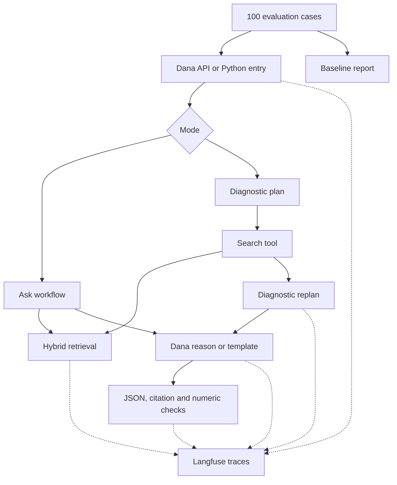

# Dana Day 1

## Flow



## Local Langfuse

Use the [official Compose deployment](https://langfuse.com/self-hosting/deployment/docker-compose). Start it under its own Compose project name, for example `dana-langfuse`, and bind the web UI to loopback. Keep its volumes separate from Dana and MMS. Default URL is http://localhost:3000. Create a Dana project and obtain its two project keys.

Install `requirements-day1.txt` in Dana's Python environment. Set `DXA_TRACE=1`, `LANGFUSE_BASE_URL=http://localhost:3000`, `LANGFUSE_PUBLIC_KEY` and `LANGFUSE_SECRET_KEY` in the Dana process, then restart the API. Open the Dana project and run an Ask and a multi-turn Diagnose. Compare the nested timings and error status in Traces.

The export contains operational metadata such as case IDs, decisions, counts and timings. Prompts, evidence text and answer text stay out of the custom telemetry. Usage is recorded when the provider supplies it. Configure a matching model definition and its currency rates in Langfuse for model-based cost estimates. Costs remain unknown for calls with missing usage or pricing.

## Reproduce evaluation

From the Dana folder in an isolated copy with the existing index:

```powershell
python day1_eval.py --output day1-baseline.json
python day1_eval.py --judge gemma4-optimized:latest --output day1-judged-local.json
```

The first command exercises the current Dana offline path. The second adds the local Ollama judge through DeepEval and continues to exercise the same Dana offline path. Set `--judge-limit 1` to check the judge connection and metric adapters. The runner suppresses feedback writes and never calls Gemini. The gold references for correctness come from existing case entries. Faithfulness uses retrieved evidence. Relevance uses the submitted question. Semantic scoring is limited to labelled, in-scope cases that received answers. The baseline reports a task success proxy: answer with at least one gold case citation, or expected refusal with no sources. This proxy does not measure successful repair.

## Baseline on 26 November 2026

| Group | Cases | Hit@1 | Hit@3 | Mean recall@3 | Task success proxy | Latency p50 / p95 |
| --- | ---: | ---: | ---: | ---: | ---: | ---: |
| Existing repository labels | 54 | 45/46 | 46/46 | 97.83% | 54/54 | 18.08 / 23.86 ms |
| Newly authored, awaiting review | 46 | 40/46 | 45/46 | 97.83% | 13/46 | 22.26 / 26.81 ms |

The 54 existing labels include 8 expected refusals, all of which passed. Hit and recall denominators count only questions with a gold case ID. The gate rejected 33 of the 46 new prompts. Correctness, faithfulness and relevance have zero scored cases in the deterministic baseline. The [per-case output](day1-baseline.json) records the mode, answer path and timing. All 100 calls ran in `dana-offline`; the baseline includes a cold start and uses a local copy of the existing index. The [dataset](day1-cases.json) distinguishes repository labels from newly authored prompts. Repository labels are existing regression expectations rather than technician validation of generated answers.

The built-in Agentic regression passed 5/5. Local Docker Engine denied pipe access, and port 3000 had no active Langfuse service during this run. A live dashboard and paid-provider usage and cost were therefore unverified.

The SDK HTTP export smoke also passed with a temporary loopback collector, including a simulated usage-bearing Dana generation and a deliberately triggered error.
