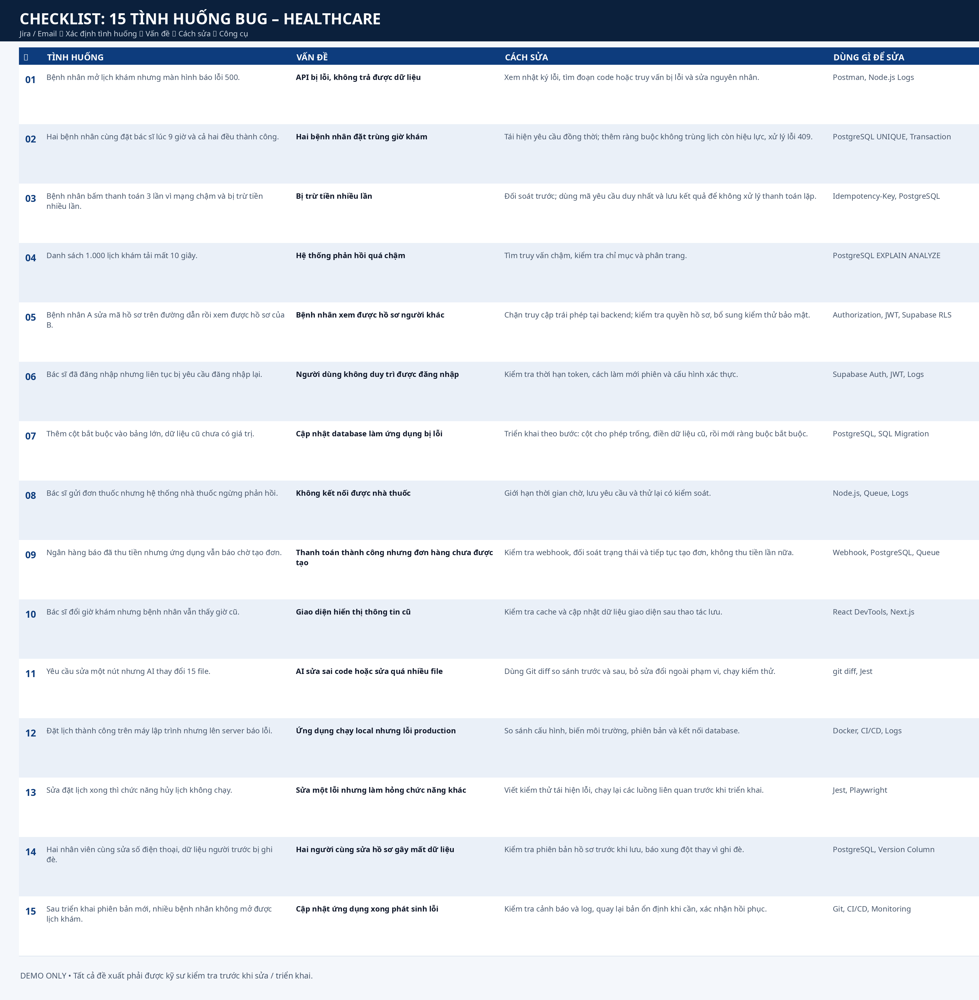
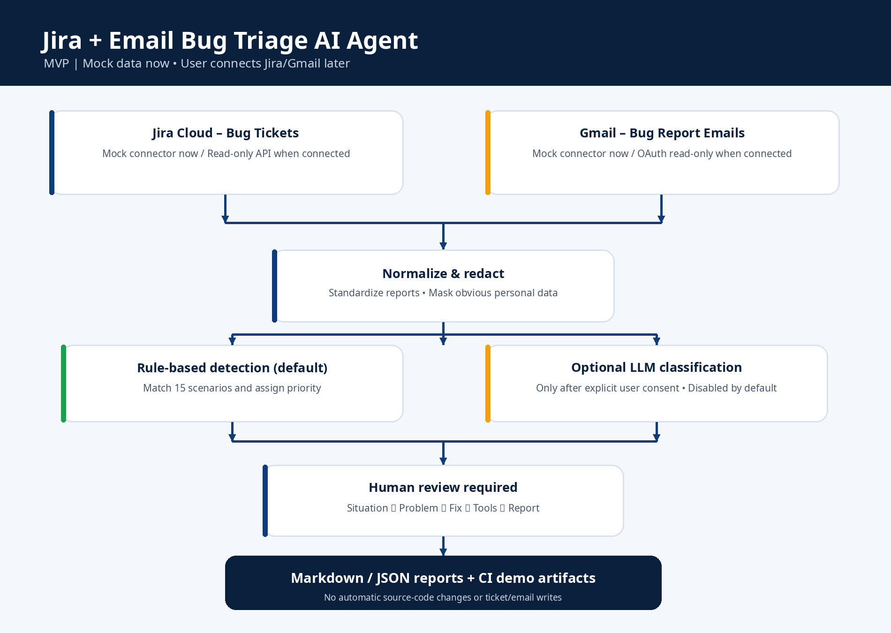

# Jira + Email Bug Triage AI Agent (Healthcare MVP)

> **Status: working offline MVP; NO Jira/Gmail connection yet.** Users connect their own services later.
> The sample data below is synthetic. This agent **triages reported incidents**, it **does not scan source code**, repair production code, send emails, edit Jira issues, or access patient records.

## CHECKLIST: 15 TÌNH HUỐNG BUG – HEALTHCARE

**Bảng đầy đủ:** Tình huống → Vấn đề → Cách sửa → Dùng gì để sửa. Xem trực tiếp ngay trên README hoặc mở ảnh PNG bên dưới.



| ✓ | Tình huống | Vấn đề | Cách sửa | Dùng gì để sửa |
|---|---|---|---|---|
| ☐ | Bệnh nhân mở lịch khám nhưng màn hình báo lỗi 500. | API bị lỗi, không trả được dữ liệu | Xem nhật ký lỗi, tìm đoạn code hoặc truy vấn bị lỗi và sửa nguyên nhân. | Postman, Node.js Logs |
| ☐ | Hai bệnh nhân cùng đặt bác sĩ lúc 9 giờ và cả hai đều thành công. | Hai bệnh nhân đặt trùng giờ khám | Tái hiện yêu cầu đồng thời; thêm ràng buộc không trùng lịch còn hiệu lực, xử lý lỗi 409. | PostgreSQL UNIQUE, Transaction |
| ☐ | Bệnh nhân bấm thanh toán 3 lần vì mạng chậm và bị trừ tiền nhiều lần. | Bị trừ tiền nhiều lần | Đối soát trước; dùng mã yêu cầu duy nhất và lưu kết quả để không xử lý thanh toán lặp. | Idempotency-Key, PostgreSQL |
| ☐ | Danh sách 1.000 lịch khám tải mất 10 giây. | Hệ thống phản hồi quá chậm | Tìm truy vấn chậm, kiểm tra chỉ mục và phân trang. | PostgreSQL EXPLAIN ANALYZE |
| ☐ | Bệnh nhân A sửa mã hồ sơ trên đường dẫn rồi xem được hồ sơ của B. | Bệnh nhân xem được hồ sơ người khác | Chặn truy cập trái phép tại backend; kiểm tra quyền hồ sơ, bổ sung kiểm thử bảo mật. | Authorization, JWT, Supabase RLS |
| ☐ | Bác sĩ đã đăng nhập nhưng liên tục bị yêu cầu đăng nhập lại. | Người dùng không duy trì được đăng nhập | Kiểm tra thời hạn token, cách làm mới phiên và cấu hình xác thực. | Supabase Auth, JWT, Logs |
| ☐ | Thêm cột bắt buộc vào bảng lớn, dữ liệu cũ chưa có giá trị. | Cập nhật database làm ứng dụng bị lỗi | Triển khai theo bước: cột cho phép trống, điền dữ liệu cũ, rồi mới ràng buộc bắt buộc. | PostgreSQL, SQL Migration |
| ☐ | Bác sĩ gửi đơn thuốc nhưng hệ thống nhà thuốc ngừng phản hồi. | Không kết nối được nhà thuốc | Giới hạn thời gian chờ, lưu yêu cầu và thử lại có kiểm soát. | Node.js, Queue, Logs |
| ☐ | Ngân hàng báo đã thu tiền nhưng ứng dụng vẫn báo chờ tạo đơn. | Thanh toán thành công nhưng đơn hàng chưa được tạo | Kiểm tra webhook, đối soát trạng thái và tiếp tục tạo đơn, không thu tiền lần nữa. | Webhook, PostgreSQL, Queue |
| ☐ | Bác sĩ đổi giờ khám nhưng bệnh nhân vẫn thấy giờ cũ. | Giao diện hiển thị thông tin cũ | Kiểm tra cache và cập nhật dữ liệu giao diện sau thao tác lưu. | React DevTools, Next.js |
| ☐ | Yêu cầu sửa một nút nhưng AI thay đổi 15 file. | AI sửa sai code hoặc sửa quá nhiều file | Dùng Git diff so sánh trước và sau, bỏ sửa đổi ngoài phạm vi, chạy kiểm thử. | git diff, Jest |
| ☐ | Đặt lịch thành công trên máy lập trình nhưng lên server báo lỗi. | Ứng dụng chạy local nhưng lỗi production | So sánh cấu hình, biến môi trường, phiên bản và kết nối database. | Docker, CI/CD, Logs |
| ☐ | Sửa đặt lịch xong thì chức năng hủy lịch không chạy. | Sửa một lỗi nhưng làm hỏng chức năng khác | Viết kiểm thử tái hiện lỗi, chạy lại các luồng liên quan trước khi triển khai. | Jest, Playwright |
| ☐ | Hai nhân viên cùng sửa số điện thoại, dữ liệu người trước bị ghi đè. | Hai người cùng sửa hồ sơ gây mất dữ liệu | Kiểm tra phiên bản hồ sơ trước khi lưu, báo xung đột thay vì ghi đè. | PostgreSQL, Version Column |
| ☐ | Sau triển khai phiên bản mới, nhiều bệnh nhân không mở được lịch khám. | Cập nhật ứng dụng xong phát sinh lỗi | Kiểm tra cảnh báo và log, quay lại bản ổn định khi cần, xác nhận hồi phục. | Git, CI/CD, Monitoring |




## What it does

1. **Ingest** bug descriptions from either a simulated Jira board or simulated bug-report emails. The same app supports Jira Cloud and Gmail read-only adapters, disabled by default.
2. **Detect & classify** bug-report text into the 15 scenarios in the checklist above; unmatched reports are labeled `REVIEW`. The offline engine uses transparent rule matching. Optional OpenAI-based text classification can be enabled explicitly after reviewing data-sharing requirements.
3. **Suggest** potential problem, next diagnostic/fix steps, recommended tools, and severity. A human must verify the root cause and approve any fix.
4. **Export** `reports/triage_report.md` and `reports/triage_report.json`; the Markdown report is in Vietnamese and uses the exact column order requested.
5. **Automation**: GitHub Actions may run the offline demo every weekday at 09:00 Asia/Ho_Chi_Minh, or manually via `workflow_dispatch`. Default scheduled runs only scan sample data until real credentials are explicitly configured.

## Quick start (no API keys, no Jira/Gmail)

```bash
git clone https://github.com/ydangishere/dev-projects.git
cd dev-projects/jira-email-bug-triage-agent
python -m unittest discover -s tests -v
python -m triage_agent.cli --mode mock --output reports
```

Open `reports/triage_report.md` to review the simulated incidents. This workflow uses **Python standard library only**. It is runnable locally without secrets, network, AI credits, or cloud accounts.

**Example console output:**

```text
Ran 4 tests ... OK
Mode=MOCK | items=16 | classified=15
Reports: reports/triage_report.md | reports/triage_report.json
Advisory only. No ticket, email, code or database modifications made.
```

## Architecture

```text
                 [Jira Cloud / Gmail API]
                          | (connect later; readonly)
            +-------------+--------------+
            |                            |
     [Jira connector]              [Gmail connector]
            +-------------+--------------+
                          |
              [Normalize + redact PII]
                          |
              [Rule classifier (default)]
                   |             |
              [Optional LLM]  [Unknown -> REVIEW]
                   |             |
                   +-------------+
                          |
             [Human verification required]
                          |
             [Markdown + JSON report]
```

- **Source layer**: `triage_agent/connectors.py` chooses `mock`, `jira`, `gmail`, or `both` via CLI. It never connects in `mock` mode.
- **Triage**: `triage_agent/engine.py`, with rule patterns and an optional LLM (large language model) reviewer. Email/body text is **untrusted** and not followed as instructions. Email addresses and obvious phone numbers are redacted before AI classification and reports; this is *not* comprehensive medical de-identification.
- **Knowledge base**: `triage_agent/knowledge.py` owns the 15 human-review recommendations. Classifier does not run repair commands.
- **Reports**: `triage_agent/report.py`, UTF-8 Markdown and JSON.
- **Tests**: `tests/test_triage.py`; fixture set covers all 15 categories and one unrelated email.

### Example: two patients booked same slot

`POST /appointments` → backend checks availability → both concurrent requests see the slot free → both try `INSERT` → database must enforce a uniqueness rule for active slots → backend maps the duplicate insert failure to HTTP 409.

This recommendation must be adapted to the actual schema and cancellation policy: a naive UNIQUE constraint over all historical rows may prevent rebooking cancelled slots.

## Connect your Jira later (NOT active by default)

1. Install optional connector dependencies: `python -m pip install -r requirements-connectors.txt`.
2. Create `.env` or set the local environment variables shown in `.env.example`: `JIRA_BASE_URL`, `JIRA_EMAIL`, `JIRA_API_TOKEN`, optionally `JIRA_JQL`.
3. Use a read-only Jira account/API token with minimum necessary permissions and only the agreed bug projects. Never commit tokens or patient information.
4. Run explicitly: `python -m triage_agent.cli --mode jira --output reports`.

The connector calls Jira Cloud's REST issue-search endpoint `/rest/api/3/search/jql` and reads only fields necessary for classification. It does **not** modify tickets.

## Connect your Gmail later (NOT active by default)

1. Use Google Cloud to create an OAuth (user authorization) Desktop client with Gmail API enabled and **read-only scope** `https://www.googleapis.com/auth/gmail.readonly`.
2. Install `python -m pip install -r requirements-connectors.txt -r requirements-oauth.txt`.
3. Download the Google OAuth client JSON file to your **local secure folder**, never to Git, then run `python tools/authorize_gmail.py --credentials path/to/client_secret.json --token path/to/gmail-token.json`.
4. Set `GMAIL_TOKEN_FILE` to that local token path and optionally set `GMAIL_QUERY` to filter relevant bug-report mail.
5. Run: `python -m triage_agent.cli --mode gmail --output reports`.

Gmail connector reads **message metadata and snippet only**; no send, delete, archive, or label permission. For `--mode both`, credentials for both services must be configured. For healthcare, assess data processing agreements and consent before granting access to clinical content.

## Optional AI classification (off by default)

Rule-based detection is deterministic and works without API keys. To use OpenAI for ambiguous snippets, install `requirements-ai.txt`, set `ENABLE_AI=true`, `OPENAI_API_KEY` and optionally `OPENAI_MODEL`, then choose a mode.

- **Do not enable AI on real patient messages without organization authorization, data minimization and privacy review.** Current redaction is demonstration-grade only.
- Classifier supplies the LLM with **redacted, truncated** title/snippet, labels `1..15`, and an instruction to treat text as untrusted data.
- AI result is constrained to a known category; service errors fall back to rule matching. Output is not a substitute for reading logs, code, API traces and confirming root cause.

## GitHub Actions automation (safe default)

The workflow must be in repo-root `.github/workflows/bug-triage-agent.yml` (a copy is provided in this project for standalone use). It runs tests and MOCK mode, and uploads 7-day report artifacts, weekdays 09:00 Vietnam time. It does **not** automatically send the findings to anyone. To run with real connected data in the future, change the mode and explicitly configure encrypted secrets, scope restrictions and your organization's security policy.

## Safety / MVP limitations

- Scans **bug reports described in Jira/email**, not an application source repository or runtime telemetry; it cannot prove a bug exists.
- No auto-fixes, auto-merge, auto-triage ticket edits or external email replies; no patients, medical advice or production deployment.
- `confidence` is a heuristic indicator, **not** a statistically calibrated probability.
- Fuzzy or ambiguous wording can cause misclassification. Always mark suggested fixes as requiring human confirmation.
- Never expose OAuth tokens, API keys, patient identifiers, medical records, or full email bodies in repository artifacts; for real deployments use approved storage and stronger PII/PHI redaction.
- For operational use, add least-privilege access, audit logs, encryption, robust pagination/backoff, source-filtering and controlled retention before connecting production accounts.

## Project portfolio (accurate wording)

**Jira & Email Bug Triage AI Agent (MVP)** — Built a Python-based, healthcare-oriented issue triage prototype with mock Jira/Gmail inputs, 15 scenario-to-fix mappings, prioritization, privacy-aware reporting, Markdown/JSON exports, unit tests and GitHub Actions demo scheduling; prepared read-only connector adapters and optional LLM classification for later user-authorized integration. **No live Jira/Gmail connection or production deployment claimed.**

**Demo project** | Python, Jira REST API adapter, Gmail API OAuth adapter, optional OpenAI API, unittest, GitHub Actions | Offline mock mode by default.
