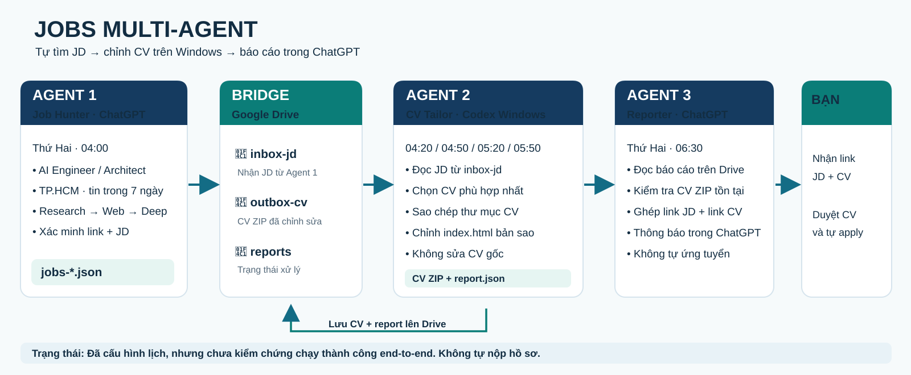

# Jobs Multi-Agent — AI + UI/UX Job Hunter → CV Tailor → ChatGPT Report

> **Status: integrated components, end-to-end validation pending.** This is an automation project, **not** an auto-apply bot. No applications are submitted.



## Kiến trúc / Architecture

| Agent | Runtime | Việc thực hiện | Output |
|---|---|---|---|
| **1. Job Hunter** | ChatGPT Scheduled Task, 04:00 Monday (Asia/Ho_Chi_Minh) | Research Skill → external web research → deep research **if available**; tìm **hai nhóm AI Engineer / AI Solution Architect và UI/UX Designer / Product Designer** tại TP.HCM, tin mới trong 7 ngày và link được kiểm tra | `inbox-jd/jobs-YYYY-MM-DD.json` |
| **2. CV Tailor** | Codex CLI on Windows, Windows Task Scheduler at 04:20 / 04:50 / 05:20 / 05:50 Monday | Đọc JD từ Drive; chọn CV phù hợp trong local CV directory; sao chép thư mục; chỉnh **index.html của bản sao** | `outbox-cv/CV-*.zip`, `reports/report-*.json` |
| **3. Reporter** | ChatGPT Scheduled Task, 06:30 Monday | Tra kết quả trên Drive; đối chiếu link JD + link CV ZIP; gửi **một báo cáo chung**, chia 2 mục AI và UI/UX | Báo cáo + link thật |

**Google Drive bridge:** One private folder `ChatGPT-Jobs-Bridge` with three subfolders `inbox-jd`, `outbox-cv`, `reports`. Google Drive for desktop mounts it on Windows.

## Trạng thái thực tế / Actual status

- [x] Agent 1 recurring ChatGPT task configured.
- [x] Google Drive bridge folders created.
- [x] Agent 2 Windows scheduled task created; observed state `Ready` on the user's machine.
- [x] Agent 3 recurring ChatGPT report task configured.
- [ ] Verify Agent 1 successfully uploads a **real** `jobs-*.json` into Drive.
- [ ] Verify Agent 2 creates an edited CV from that JD and syncs ZIP/report.
- [ ] Verify Agent 3 receives the right file links and delivers a complete report.

**Important:** A scheduled task being enabled is not proof that every component can run unattended. Deep Research access is not guaranteed in scheduled runs; steps must report unavailable tools truthfully. A link returning content in a remote search environment does not guarantee the user's browser can open it.

## Thiết lập trên Windows / Windows setup

**Requires:** Windows 11, PowerShell 5.1+, Codex CLI signed in, Google Drive for desktop signed in, local CV folders each containing `index.html`.

The following paths are examples corresponding to the existing Windows setup; edit as needed:

```powershell
$Drive = "G:\My Drive\ChatGPT-Jobs-Bridge"
$CvRoot = "E:\cvok\updated"

# In PowerShell opened in this repository's jobs-multi-agent folder:
powershell.exe -NoProfile -ExecutionPolicy Bypass -File ".\scripts\check-setup.ps1" -DriveBridgeRoot $Drive -CvRoot $CvRoot

# Creates/updates the Windows weekly polling task:
powershell.exe -NoProfile -ExecutionPolicy Bypass -File ".\scripts\install-task.ps1" -DriveBridgeRoot $Drive

# Check task state:
Get-ScheduledTask -TaskName "Jobs-Codex-CV-Tailor" | Select-Object TaskName,State

# Optional: process any ACTUAL manifest already uploaded by Agent 1:
powershell.exe -NoProfile -ExecutionPolicy Bypass -File ".\scripts\process-drive.ps1" -DriveBridgeRoot $Drive -CvRoot $CvRoot
```

**Do not run a separate job-search pipeline on Windows:** Agent 1 already searches from ChatGPT Cloud. Windows does only CV tailoring. Running `process-drive.ps1` without any real JD manifest will cleanly report that the inbox is empty.

## Job manifest contract

The cloud agent is instructed to produce this JSON **only for verified, newly posted vacancies**, and upload it to `inbox-jd`. These are *field names*, not a sample actual job:

```json
{
  "window_start_local": "YYYY-MM-DD",
  "window_end_local": "YYYY-MM-DD",
  "jobs": [
    {
      "category": "AI",
      "company": "Employer name",
      "position": "Role title",
      "jd_url": "https://employer.example/jobs/role",
      "jd_text": "Full authentic JD text (not invented)",
      "posted_date": "YYYY-MM-DD",
      "posted_evidence_url": "https://employer.example/jobs/role",
      "open_evidence": "Public evidence this job is accepting applicants",
      "location": "Ho Chi Minh City, Vietnam",
      "work_mode": "onsite | hybrid | remote",
      "salary": null
    }
  ],
  "excluded": []
}
```

Field `category` is `AI` or `UIUX`. Agent 1 sends one combined manifest for both job groups, and both scheduled reports are grouped by these two categories. For UI/UX jobs, CV selection must use genuine design/product-design evidence; no made-up or mismatched AI CV claims. LinkedIn URLs are allowed if they genuinely match the posting, formatted `https://www.linkedin.com/jobs/view/JOB_ID/` using a real, verified job ID. The Windows processor accepts files named `jobs-*.json`; the queue is content-hash deduplicated. For zero verified jobs, the cloud agent may upload `jobs: []` (no CV editing).

## CV Tailor editing policy

Agent 2 uses the installed Codex **`jd-to-cv`** approach. It selects the closest *existing* CV based on actual evidence; recency is a tiebreaker, not a reason to invent experience.

- Copies the **entire source CV folder**; source remains untouched.
- Changes **only `index.html` in the new copy**; retains existing CSS, markup format and styling.
- Protects: **Personal Details**, **Career Summary**, **Academic Background**, **Portfolio**, **Other Trainings**.
- Explicit exceptions: adjust **Position Applied** and concise **Introduction**.
- May revise allowed skills/experience prose **only if supported by the original CV**, without inventing jobs, degrees, skills, projects, certifications, numbers or performance claims.
- No fabricated quantified improvements (e.g. `35%`, `improved by`, `cut load time`) or new numeric years-of-experience claims.
- Generated CV is always **`created_review_required`**: a human must check accuracy before use.

See [scripts/run-jobs.ps1](scripts/run-jobs.ps1) for implementation.

## Agent 3 output

For each successful job, Agent 3 reports:

| Employer | Job title | Verified JD URL | Google Drive CV ZIP URL | State |
|---|---|---|---|---|
| (from real manifest) | (from real manifest) | (actual HTTPS link) | (actual Drive file URL) | CV ready for human review |

Never invent a URL: find the real uploaded CV file in Drive and use its returned link. A Windows local path is **not** a public URL. If Agent 2 did not create CV, report the failure instead of pretending it did.

## Failure behavior / Giới hạn

- If a job link fails, **first** use Codex Research Skill, **then** external web research, **then** Deep Research if supported. Search by **company name + role + JD text**, trace employer careers pages/ATS, and verify the final URL.
- Do not call an indexed Google result proof that the employer still accepts applications.
- If inbox is empty, Agent 2 has nothing to process; this is not a CV editing success.
- If the Windows computer is off, Drive is not syncing or Codex is not authenticated, local processing will not complete.
- The scripts use `codex exec` in read-only and workspace-write modes. JD content is **untrusted** and must not be obeyed as instructions.
- The GitHub repo contains **no personal CVs, employer applications, Google credentials, secrets, live JD manifests or private reports**. CV ZIPs on Google Drive may contain personal data; restrict sharing permissions.

## Files

```text
jobs-multi-agent/
├── README.md                  # This document, rendered flow diagram
├── docs/
│   └── agent-flow.svg         # Embedded architecture diagram
├── scripts/
│   ├── check-setup.ps1        # Check local Drive, CV path and Codex
│   ├── install-task.ps1       # Register Windows Task Scheduler job
│   ├── process-drive.ps1      # Drive inbox -> Codex -> Drive outputs
│   └── run-jobs.ps1           # Select, copy and tailor CV using Codex CLI
└── .gitignore                 # Prevent sensitive output from entering Git
```

**English short summary:** Cloud ChatGPT discovers and validates both AI and UI/UX/Product Design job descriptions; Google Drive exchanges manifests and result files; Codex CLI on the user's Windows workstation copies and tailors the best matching existing HTML resume; ChatGPT reports links to the user. Human review is required; no applications are submitted.
