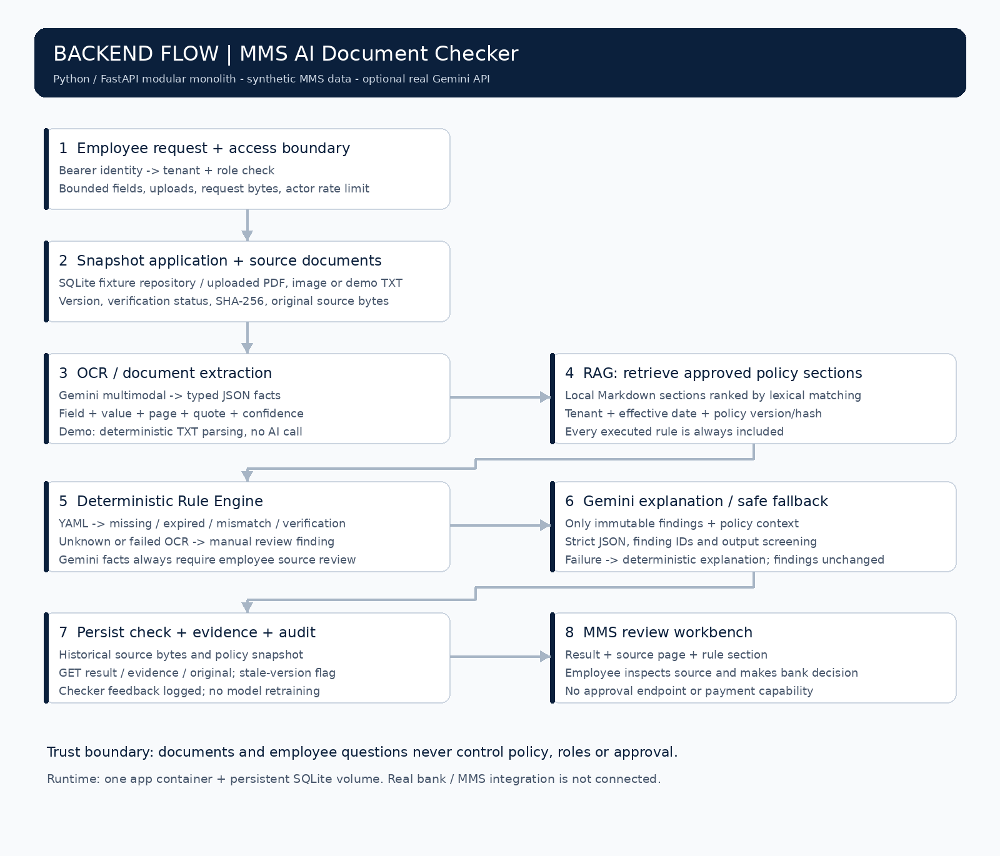
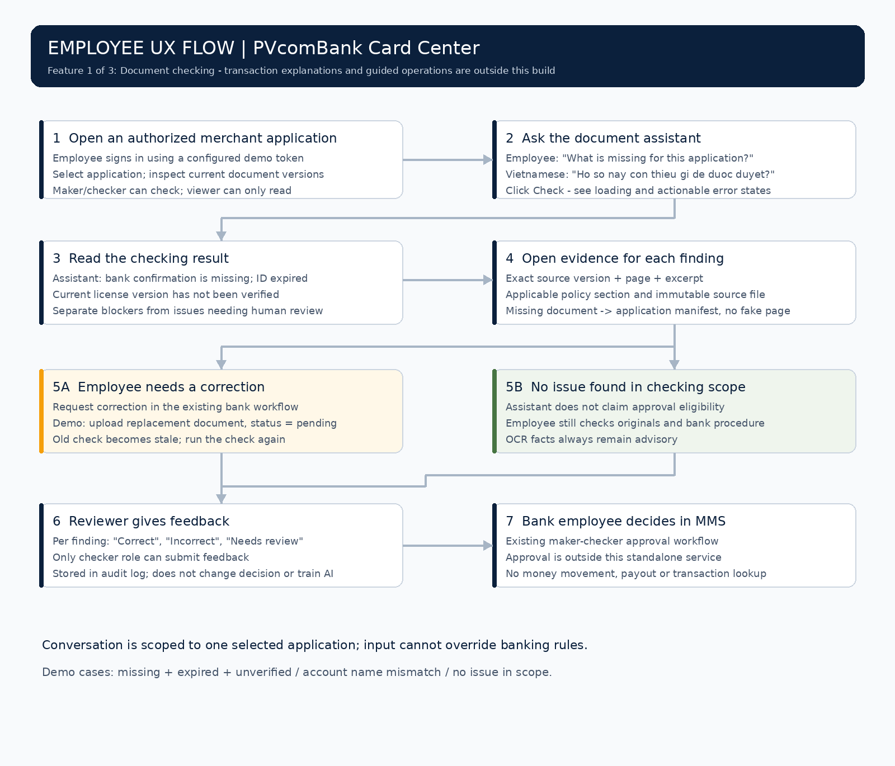

# VietPay MMS — AI Document Checker

**MMS website demo:** [View demo](https://ydangkuul.github.io/mms130926/index.html)

> The linked MMS website is a separate UI reference/demo. It is **not** connected to this AI Document Checker backend, and does not imply a production bank integration.


[Tiếng Việt](README.vi.md) · [Security model](docs/SECURITY.md) · [Server deployment](docs/DEPLOYMENT.md) · [Test evidence](docs/VALIDATION.md)

An end-to-end runnable **document-checking assistant for VietPay MMS**, a merchant management system in a payment-company context. Its intended primary users are **PVcomBank Card Center employees**, including the bank's maker and checker roles.

This is an independent portfolio prototype. It is **not an official VietPay/PVcomBank deployment**, has no access to bank systems, and includes only synthetic applications and a synthetic policy. It supports real Gemini calls when configured; default demo mode is deterministic and does not call an AI model.

## One feature within a three-feature assistant

| Assistant capability | Employee asks | Scope of this repository |
|---|---|---|
| **Document checking** | “What is missing for this application to be approved?” | **Implemented:** missing documents, expiry, inconsistent information, unverified versions, uncertainty and evidence |
| Explain transactions and payouts | “Why has this business not received its money?” | Not implemented; would retrieve status, fees and errors and separate confirmed causes from open questions |
| Guide handling | “What should I do now?” | Not implemented; would follow internal procedures and navigate to the relevant application/screen |

The checking UI can identify an issue and its rule. This does not implement the separate general procedural-guidance assistant. It does not approve, reject, change KYC/KYB status, request documents externally or move money.

## Quick start

Python **3.12** and a modern browser are sufficient. Start from the monorepo root:

```bash
cd mms-ai-checker
python -m venv .venv
source .venv/bin/activate
pip install -r requirements.txt
cp .env.example .env
python -m uvicorn app.main:app --env-file .env --host 127.0.0.1 --port 8000 --no-access-log
```

On Windows PowerShell, replace activation and copy with:

```powershell
cd mms-ai-checker
py -3.12 -m venv .venv
.\.venv\Scripts\Activate.ps1
pip install -r requirements.txt
Copy-Item .env.example .env
python -m uvicorn app.main:app --env-file .env --host 127.0.0.1 --port 8000 --no-access-log
```

Open **http://127.0.0.1:8000**, enter `demo-checker-token`, connect, select an application and click **Kiểm tra hồ sơ**. Open **Xem căn cứ** for a finding, inspect the source and policy, then submit a correct/incorrect/needs-review assessment. Logout removes the token from page memory.

| Sample | Expected behavior |
|---|---|
| `APP-DEMO-001` | Missing bank confirmation, expired ID, license v2 not verified |
| `APP-DEMO-002` | Bank-confirmation name differs; human review, not a fraud finding |
| `APP-DEMO-003` | No issue found within demo rules; **not approval eligibility** |

Demo tokens: `demo-maker-token` can upload/check; `demo-checker-token` also submits feedback; `demo-viewer-token` only reads. These are deliberately public local-demo credentials. For a TXT replacement, create a UTF-8 file containing e.g. `expires_on: 2030-12-31`. Uploading always creates a pending version; the service cannot mark it verified.

### Enable real Gemini PDF/image reading

Edit local `.env` (never commit it):

```dotenv
AI_MODE=gemini
GEMINI_MODEL=gemini-3.8-flash
GEMINI_API_KEY=YOUR_OWN_KEY
```

Restart the server, open an application and upload synthetic PDF/JPEG/PNG documents into the appropriate document slots. Maximum **5 MiB per file, 20 PDF pages, 20 million image pixels**. Replace all TXT sample slots if you want to exercise an entirely PDF/image-based application. Uploads remain pending upstream verification.

The implementation uses the Google GenAI SDK `models.generate_content`, multimodal document input and JSON Schema output. Gemini supplies field values, page, quote and confidence; it does not set verification or approval. OCR here means the document-reading stage using Gemini's native vision; a separate OCR vendor is not required. Failed or unknown extraction becomes a review finding. No API key is shipped; live Gemini validation requires your key and account access.

**Model starting point:** `gemini-3.8-flash`, chosen for documented PDF/image inputs and structured outputs. This is an architectural choice, not a measured quality/cost claim for Vietnamese bank documents. Evaluate scan quality, field accuracy, fabricated sources, latency, token cost and data handling before choosing a production model. Model ID is configurable. [Official model documentation](https://aistudio.google.com/docs/models/gemini-3.8-flash), [document input](https://aistudio.google.com/docs/document-processing), [structured output](https://aistudio.google.com/docs/structured-output), checked 2026-11-05.

## Backend flow



**OCR reads documents → RAG finds policy → Rule Engine checks → Gemini explains.**

1. FastAPI authenticates a server-configured principal and checks tenant/role. It reads application metadata and current source bytes from the repository adapter, currently SQLite fixtures/uploads.
2. Demo mode parses known TXT fields. Gemini mode reads actual PDF/images into strict Pydantic JSON: `field`, `value`, `page`, `quote`, `confidence`. Unknown values are omitted and treated as uncertainty.
3. RAG loads versioned local Markdown sections, scopes policy to tenant and effective date, then ranks sections by lexical matching. Every rule used by the checker is always included. This is **local lexical RAG, not embedding/vector-database RAG**. The question cannot suppress a rule or substitute a policy file.
4. The Python Rule Engine executes synthetic `rules.yaml`: required document types, expiry, normalized names/registration numbers, current verification version and minimum extraction confidence. Rules determine findings; the LLM cannot remove them.
5. Gemini receives immutable findings and retrieved policy sections for explanation, without raw document quotes, names or registration IDs in this second call. Strict JSON, known finding IDs and output screening are enforced. Invalid/model-failed explanations fall back to deterministic text. Extracting documents still sends their original content to Google when Gemini mode is selected.
6. SQLite stores the application snapshot, source bytes/versions/hashes, extracted JSON, findings, exact retrieved policy sections/hash and audit events. Evidence comes from this historical snapshot. Replacing a document makes old results stale and blocks feedback until a new check.

Hard findings and AI explanation are displayed separately. Gemini quotes are **model-proposed evidence**, not guaranteed ground truth: page bounds and value/quote consistency are checked, but employees must inspect the actual source. All Gemini-read documents receive an explicit human-review finding.

### What MD, YAML and JSON do

| Format | Used for |
|---|---|
| Markdown | Versioned human-readable policy sections for retrieval |
| YAML | Controlled machine-readable thresholds and required documents |
| JSON | Sample applications, typed extracted facts, API requests/results and evaluation output |
| Original PDF/image/TXT | Historical evidence; preserved rather than replaced by extracted text |

Markdown/YAML/JSON are storage formats. They do not, by themselves, implement RAG or an AI agent. The retrieval and orchestration code makes them part of the workflow.

## Employee UX flow



Example conversation: employee asks **“Hồ sơ này còn thiếu gì để được duyệt?”** The assistant identifies missing bank confirmation, an expired ID and an unverified license version, each linked to a policy section and source. The employee inspects originals, asks for correction through the existing bank workflow and runs a new check after upload. Feedback is persisted for review; it never automatically retrains the model or changes an approval.

The conversation is deliberately bounded to checking the selected application. Arbitrary questions are not executed as tools or policy instructions. No autonomous multi-agent system or general banking chatbot is claimed.

## REST APIs

All `/api/*` endpoints require `Authorization: Bearer <token>`. Identity, tenant and role come only from server configuration. There are **8 business endpoint patterns** plus health and OpenAPI metadata; these are endpoints of one service, not eight microservices.

| Method / path | Purpose | Allowed role |
|---|---|---|
| `GET /api/applications` | List authorized applications | Viewer, maker, checker |
| `GET /api/applications/{id}` | Metadata and current document manifest | Viewer, maker, checker |
| `POST /api/applications/{id}/documents` | Bounded multipart upload; new pending version | Maker, checker |
| `POST /api/applications/{id}/checks` | Synchronous completed check; JSON `{ "question": "..." }` | Maker, checker |
| `GET /api/checks/{id}` | Historical result plus current stale flag | Viewer, maker, checker |
| `GET /api/checks/{id}/evidence/{finding_id}` | Exact finding, source metadata and policy section | Viewer, maker, checker |
| `GET /api/checks/{id}/documents/{document_id}` | Authorized original source download | Viewer, maker, checker |
| `POST /api/checks/{id}/feedback` | Record reviewer assessment | Checker |
| `GET /healthz` | Process/storage readiness and mode; not live-model health | Public |
| `GET /openapi.json` | Machine-readable REST contract | Public |

Example:

```bash
curl -X POST http://127.0.0.1:8000/api/applications/APP-DEMO-001/checks \
  -H 'Authorization: Bearer demo-checker-token' \
  -H 'Content-Type: application/json' -d '{"question":"Hồ sơ này còn thiếu gì?"}'
```

Important responses: `401` no identity, `403` wrong role, `404` unknown/other-tenant object, `409` unavailable policy or stale feedback, `413` request too large, `422` invalid data/file, `429` rate/capacity limit, `503` unconfigured Gemini. A check can complete with `extraction_failed` findings when a document call fails; inspect `events`, not only HTTP status.

### External integrations and banking terminology

Only the **Gemini API** is implemented as an external integration. MMS application API, document storage, employee SSO/OIDC, KYC/KYB and bank account/customer APIs are **integration seams, not connected systems**. Local SQLite fulfills the application/document repository role in this build; replace it with authenticated fixed-origin adapters to official bank contracts when available.

No issuer/acquirer transaction messaging, ISO 8583, payment authorization, clearing, settlement or reconciliation is required for this checking feature. Relevant concepts are KYC/KYB evidence, role/tenant permissions, maker-checker review and audit trails. No real banking credentials or customer data belong in this public repository.

## End-to-end engineering ownership

| Stage | What this build supplies | What production still needs |
|---|---|---|
| Define problem | Document-checking scope, employee UX, issue taxonomy and advisory boundary | Card Center stakeholder validation and approved success criteria |
| Prepare data | Three synthetic visible cases plus hidden-tenant fixture | Authorized anonymized sample set and domain-expert labels |
| Prepare policy | Synthetic Markdown/YAML, effective date, version and SHA-256 | Official approved policy owner, change review and release procedure |
| Build AI pipeline | Gemini adapter, typed extraction, lexical RAG, deterministic rules, explanations/fallback | Live Vietnamese document benchmark and chosen data-processing arrangement |
| Build product/backend | Python/FastAPI, REST, web UI, SQLite snapshots and feedback | Real MMS/storage/SSO adapters, production database if scale requires |
| Test/security | Unit/API/adversarial tests, synthetic regression evaluation, dependency audit CI | Bank penetration test, broader attack corpus, independent review |
| Package/deploy | Dockerfile, hardened local Compose, health endpoint and deployment runbook | Authorized server, TLS, secret manager, SSO, backups, operational rollout |
| Operate/improve | Audit events with stage failures and reviewer feedback | Central metrics/alerts, latency/cost/token dashboards, SLO and incident ownership |

## Docker and CI/CD

```bash
cp .env.example .env
docker compose up --build -d
docker compose logs -f checker
```

Open the same localhost URL. Docker packages one **modular monolith**. It runs as a non-root user with a read-only root filesystem, dropped capabilities, no-new-privileges, resource limits and a persistent `/data` volume. It is deployment isolation, not a complete hostile-file sandbox. No microservices, Kafka, gRPC or Kubernetes are necessary for this MVP. Checks run synchronously, two at a time, one process; larger workloads need durable jobs, distributed throttling and tested storage/queue capacity.

CI lives at [`../.github/workflows/mms-ai-checker.yml`](../.github/workflows/mms-ai-checker.yml): lint → tests → synthetic evaluation → dependency vulnerability audit → Docker build → HTTP container smoke test → evaluation artifact. Tests do not need Gemini secrets. CI is configured; verify actual run results in GitHub Actions after push. **CD is an operator deployment runbook**, not an automatic deployment to a bank server. See [deployment and rollback](docs/DEPLOYMENT.md).

## Security and limits

Implemented defenses include object-level tenant authorization, role checks, server-owned document versions, strict JSON fields, file/type/size/page limits, parameterized SQL, output escaping/CSP, model input separation, no model tools, immutable findings, source/version snapshots, bounded model calls, concurrency/actor limits and audited feedback.

Indirect prompt injection, “reverse approach” prompts (e.g. asking what *not* to do in order to extract bypass instructions), hidden/Unicode instructions, field manipulation, forged roles/verification, fabricated citations and model output abuse are covered by boundaries and selected adversarial tests. Keyword screening is only supplemental; no system can claim complete protection from every prompt attack. Read the [implemented control / residual risk matrix](docs/SECURITY.md).

Local tokens are a demo authentication mechanism, not bank SSO. Uploaded files are not malware-scanned or parsed in a separate sandbox. SQLite is not encrypted by this app. There is no production telemetry backend, live bank connection, signed policy publishing or real Gemini accuracy benchmark. All must be addressed and validated before an authorized bank pilot.

## Tests and reproducible evaluation

```bash
pip install -r requirements-dev.txt
python -m ruff check app tests scripts
python -m pytest -q
python scripts/evaluate.py
python -m pip_audit -r requirements.txt
# With the server running:
python scripts/smoke.py
```

[`docs/evaluation.json`](docs/evaluation.json) reports exact finding-code matches on **three synthetic deterministic cases**, not production accuracy or Gemini OCR quality. See [validation record](docs/VALIDATION.md) for what was actually run and what remains unverified.

For a genuine model benchmark, label field values, source pages and expected findings on held-out authorized documents. Measure missing/expired/mismatch precision/recall, unsupported-source rate, false-clean outcomes, manual-review rate, p50/p95 latency and cost per application. Never invent a “92% accuracy” or time-saving claim from these fixtures.

Code layout: `app/main.py` REST/auth/orchestration; `providers.py` Gemini/demo; `rag.py` retrieval; `engine.py` rules; `store.py` SQLite; `static/` employee UI; `policies/` MD/YAML; `samples/` JSON; `tests/`; `scripts/`; `docs/` diagrams/security/deployment. Diagram sources can be regenerated with `python scripts/diagrams.py` (Pillow and DejaVu Sans on Linux).
