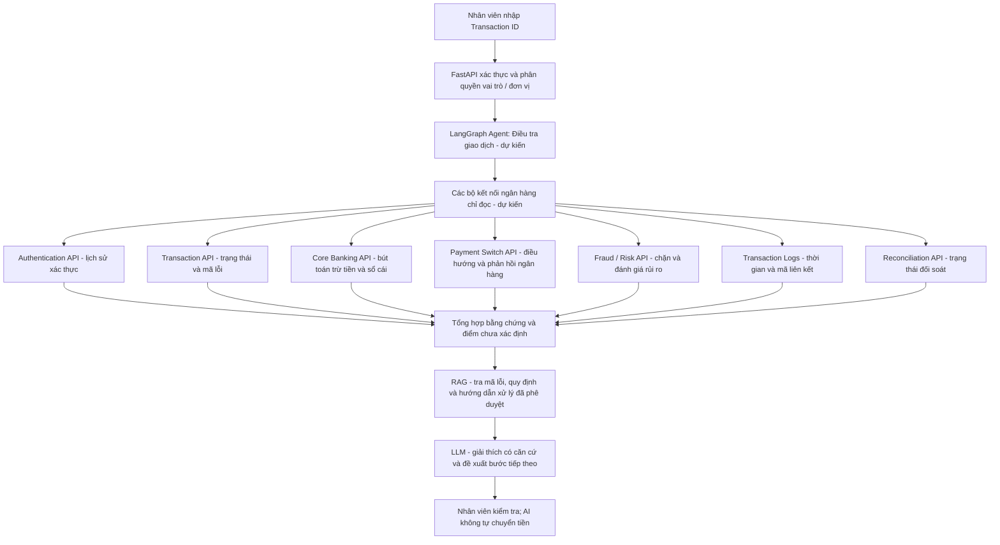
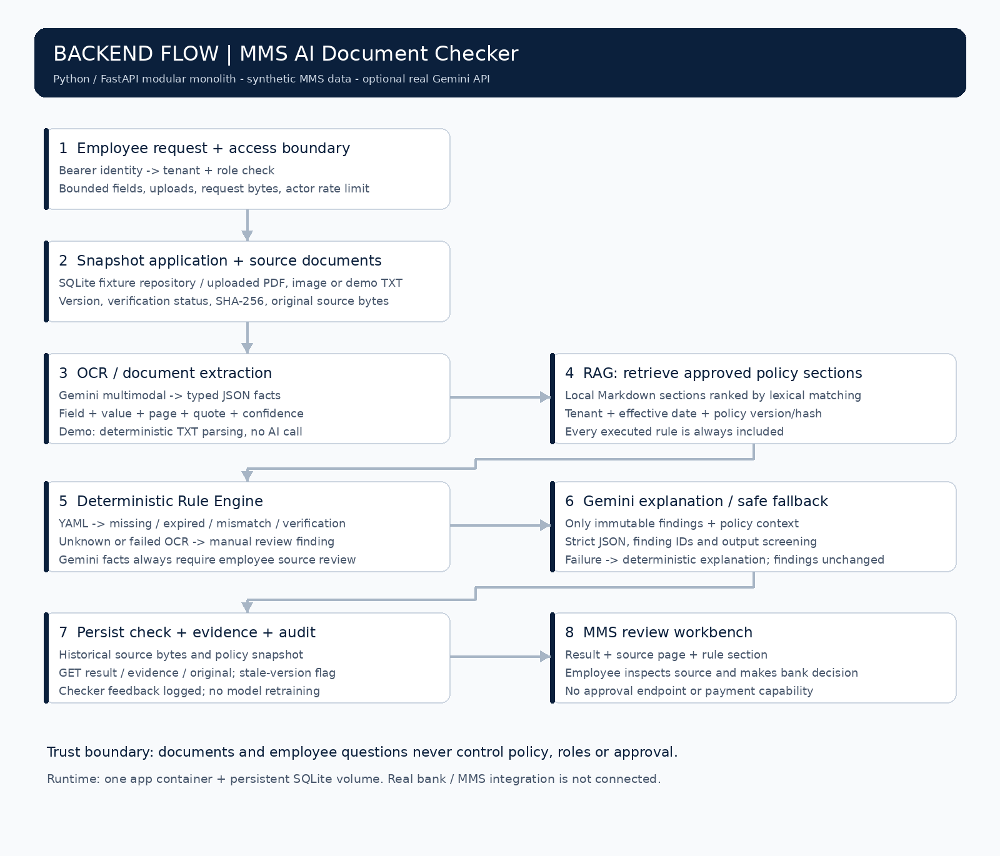
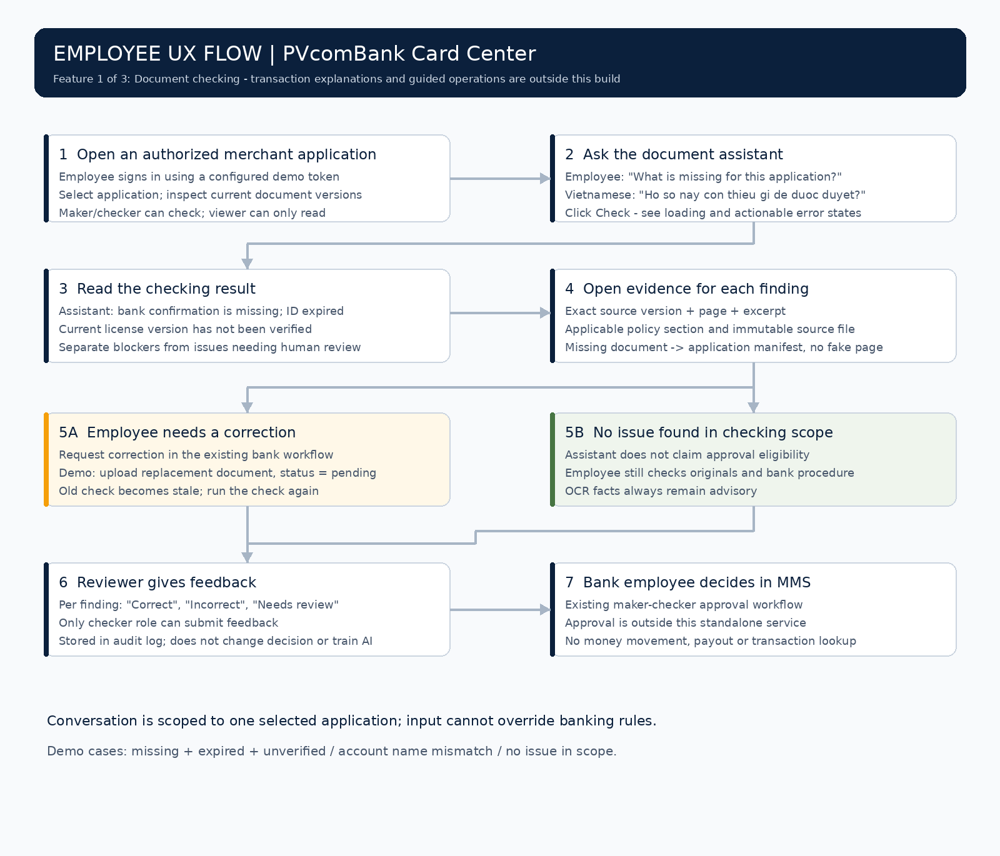

# VietPay MMS — AI kiểm tra hồ sơ

[English](README.md) · [Cơ chế bảo vệ](docs/SECURITY.md) · [Triển khai server](docs/DEPLOYMENT.md) · [Kết quả kiểm thử](docs/VALIDATION.md)

Đây là tính năng **AI kiểm tra hồ sơ của VietPay MMS**, trong bối cảnh VietPay là công ty thanh toán. **Người dùng chính được thiết kế hướng tới là nhân viên Trung tâm thẻ PVcomBank**, gồm người lập hồ sơ (maker) và người kiểm tra/duyệt (checker).

Đây là **bản thử nghiệm portfolio độc lập**, không phải hệ thống chính thức đã triển khai cho VietPay/PVcomBank. Hồ sơ và quy định đều giả lập, chưa kết nối ngân hàng thật. Có mã kết nối Gemini thật khi cung cấp API key; chế độ demo mặc định dùng luật và bộ đọc TXT, không gọi AI.

## Một tính năng trong nhóm ba tính năng

| Tính năng của trợ lý | Nhân viên hỏi | Có trong dự án này? |
|---|---|---|
| **Kiểm tra hồ sơ** | “Hồ sơ này còn thiếu gì để được duyệt?” | **Có:** tìm giấy tờ thiếu, hết hạn, thông tin không khớp, phiên bản chưa xác minh; kèm nguồn |
| Giải thích giao dịch và chi trả | “Vì sao doanh nghiệp chưa nhận tiền?” | **Không:** dự kiến tra trạng thái, phí và lỗi; phân biệt nguyên nhân đã xác nhận với điều cần kiểm tra thêm |
| Hướng dẫn xử lý | “Bây giờ tôi cần làm gì?” | **Không:** dự kiến dựa vào quy trình nội bộ để chỉ bước và mở đúng hồ sơ/màn hình |

Bản này nêu vấn đề và quy định liên quan, chưa phải trợ lý hướng dẫn nghiệp vụ tổng quát. AI không duyệt/từ chối hồ sơ, không sửa trạng thái KYC/KYB (xác minh cá nhân/doanh nghiệp), không gửi yêu cầu ra ngoài và không chuyển tiền.

## Module dự kiến: Điều tra giao dịch thất bại (chỉ thiết kế kiến trúc)

**Trạng thái: kiến trúc đề xuất, CHƯA được triển khai trong repository.** Bản demo đang chạy chỉ có **AI kiểm tra hồ sơ**. Chưa tích hợp dữ liệu giao dịch, Core Banking, Payment Switch, Fraud, đối soát của ngân hàng thật; chưa dùng LangGraph để điều tra giao dịch trong code hiện tại.



**Phân biệt dữ liệu và kiến thức:** Transaction API, Core Banking, Payment Switch, Fraud, Logs và Reconciliation cung cấp **bằng chứng của giao dịch cụ thể**. RAG (truy xuất tài liệu hỗ trợ AI trả lời) dùng để tìm **mã lỗi, quy định nội bộ và hướng dẫn xử lý**. RAG **không** thay thế API trong việc xác nhận giao dịch đã trừ/ghi có hay đối soát. Có thể tra theo từ khóa hoặc vector; dự án hiện **chưa** triển khai RAG tra lỗi giao dịch hay Vector DB.

**Nguyên tắc xử lý:** Xác thực và phân quyền trước khi truy vấn; dùng kết nối chỉ đọc, tối thiểu quyền, che dữ liệu nhạy cảm; đối chiếu Transaction ID, timestamp và correlation ID giữa các hệ thống. Phân biệt rõ `FAILED` (thất bại), `PENDING` (chờ kết quả) và `SUCCESS` (đã xác nhận thành công). Nếu đã trừ tiền nhưng Payment Switch bị timeout, chưa thể kết luận người nhận không được ghi có; phải chờ xác nhận/đối soát, **không tự động chuyển lại hay hoàn tiền**. AI cần tách bằng chứng đã xác minh khỏi điều chưa rõ và chuyển thao tác tài chính sang quy trình ngân hàng được kiểm soát.

**Các API trong sơ đồ là điểm tích hợp minh họa, không khẳng định ngân hàng đã có đúng bảy API này.**

## Cài nhanh và dùng ngay

Cần **Python 3.12** và trình duyệt. Từ thư mục gốc `dev-projects`:

**Windows PowerShell:**

```powershell
cd mms-ai-checker
py -3.12 -m venv .venv
.\.venv\Scripts\Activate.ps1
pip install -r requirements.txt
Copy-Item .env.example .env
python -m uvicorn app.main:app --env-file .env --host 127.0.0.1 --port 8000 --no-access-log
```

**Linux/macOS:**

```bash
cd mms-ai-checker
python -m venv .venv
source .venv/bin/activate
pip install -r requirements.txt
cp .env.example .env
python -m uvicorn app.main:app --env-file .env --host 127.0.0.1 --port 8000 --no-access-log
```

Mở **http://127.0.0.1:8000** → nhập `demo-checker-token` → **Kết nối** → chọn hồ sơ → **Kiểm tra hồ sơ** → **Xem căn cứ**. Đối chiếu bản gốc và quy định, rồi đánh giá từng phát hiện là đúng/sai/chưa rõ. Token chỉ giữ trong bộ nhớ trang; đăng xuất để xóa.

| Hồ sơ mẫu | Kết quả dự kiến |
|---|---|
| `APP-DEMO-001` | Thiếu xác nhận tài khoản, giấy tờ hết hạn, giấy phép v2 chưa xác minh |
| `APP-DEMO-002` | Tên trên xác nhận tài khoản không khớp; cần đối chiếu, không kết luận gian lận |
| `APP-DEMO-003` | Không phát hiện lỗi trong phạm vi luật demo; **không có nghĩa đã đủ điều kiện duyệt** |

`demo-maker-token`: tải giấy tờ và chạy kiểm tra. `demo-checker-token`: thêm quyền gửi đánh giá. `demo-viewer-token`: chỉ đọc. Các token này công khai để chạy demo trên máy cá nhân, không dùng cho hệ thống thật.

Muốn thử thay giấy tờ trong demo, tạo file TXT UTF-8 có dòng như `expires_on: 2030-12-31`, chọn loại giấy tờ và tải lên. File thay thế luôn có trạng thái chờ xác minh; kết quả kiểm tra cũ sẽ mất hiệu lực. Không có API tự đánh dấu giấy tờ đã xác minh.

### Bật Gemini để đọc PDF/ảnh thật

Sửa `.env` tại máy bạn, không đưa khóa lên Git:

```dotenv
AI_MODE=gemini
GEMINI_MODEL=gemini-3.8-flash
GEMINI_API_KEY=KHOA_CUA_BAN
```

Khởi động lại server. Vào hồ sơ, tải PDF/JPEG/PNG giả lập vào đúng loại giấy tờ rồi chạy kiểm tra. Giới hạn mỗi file **5 MiB, 20 trang PDF hoặc 20 triệu điểm ảnh**. Muốn thử toàn bộ bằng PDF/ảnh, thay tất cả giấy tờ TXT có sẵn trong hồ sơ. Bản mới vẫn chờ xác minh theo quy trình phía ngân hàng.

Model khởi đầu là **Gemini 3.8 Flash** (`gemini-3.8-flash`) vì tài liệu chính thức hỗ trợ PDF/ảnh và đầu ra có cấu trúc JSON. Đây là lựa chọn kỹ thuật để bắt đầu, chưa phải kết luận đã đo độ chính xác/chi phí trên hồ sơ ngân hàng Việt Nam. Có thể đổi model qua biến môi trường. [Tài liệu model](https://aistudio.google.com/docs/models/gemini-3.8-flash), [đọc tài liệu](https://aistudio.google.com/docs/document-processing), [JSON có cấu trúc](https://aistudio.google.com/docs/structured-output), kiểm tra ngày 05/11/2026.

Mã dùng Google GenAI SDK (thư viện kết nối Google), hàm `models.generate_content`, đầu vào PDF/ảnh và JSON Schema (khuôn dữ liệu cố định). Chưa có API key đi kèm; gọi Gemini thật cần khóa và quyền sử dụng model từ tài khoản của bạn.

## Cơ chế hoạt động và luồng backend



**OCR đọc hồ sơ → RAG tìm quy định → Rule Engine kiểm tra → Gemini giải thích.**

1. **Nhận yêu cầu và phân quyền:** FastAPI (công cụ xây backend bằng Python) kiểm tra token, vai trò và đơn vị ngân hàng. Backend lấy thông tin hồ sơ và giấy tờ hiện hành. Trong bản này nguồn là dữ liệu SQLite giả lập và file tải lên.
2. **OCR / Document AI (đọc giấy tờ):** Gemini nhìn PDF/ảnh và xuất JSON gồm trường thông tin, giá trị, trang, câu trích nguyên văn và độ tin cậy. Không rõ thì bỏ trống để nhân viên kiểm tra; không đoán. “OCR” ở đây là giai đoạn đọc tài liệu bằng khả năng nhìn của Gemini, không bắt buộc thuê dịch vụ OCR riêng. Chế độ demo chỉ đọc các dòng TXT theo mẫu.
3. **RAG (tìm tài liệu để AI tham khảo):** đọc các mục quy định Markdown, lọc theo ngân hàng và ngày hiệu lực, xếp hạng theo từ khóa. Các quy định mà bộ kiểm tra thực thi luôn được đưa vào. Đây là **RAG tìm theo từ khóa tại chỗ**, chưa dùng embedding/vector database (mã hóa và tìm theo độ gần nghĩa).
4. **Rule Engine (bộ máy chạy luật):** Python thực hiện quy tắc YAML về giấy tờ bắt buộc, hết hạn, tên/mã số không khớp, phiên bản chưa xác minh và độ tin cậy thấp. Gemini không được xóa hoặc thay đổi phát hiện này.
5. **Giải thích:** Gemini nhận danh sách phát hiện cố định và mục quy định đã tìm được, trả lời tiếng Việt theo JSON. Lần gọi giải thích không gửi tên, mã số, trích đoạn gốc hay câu hỏi người dùng; nhưng lần đọc giấy tờ có gửi bản gốc tới Google khi bật Gemini. Nếu trả sai cấu trúc, mã phát hiện lạ, nội dung bị chặn hoặc gọi model lỗi, backend dùng lời giải thích cố định và giữ nguyên phát hiện.
6. **Lưu bằng chứng:** SQLite lưu ảnh chụp dữ liệu tại thời điểm kiểm tra, phiên bản/file gốc, mã băm SHA-256 (dấu nhận diện nội dung), dữ liệu bóc ra, phát hiện, quy định và nhật ký. Khi giấy tờ thay đổi, kết quả cũ được đánh dấu lịch sử, cần chạy lại.

Phát hiện bằng luật và phần AI diễn giải hiển thị riêng. Số trang/câu trích do Gemini đề xuất **chưa bảo đảm là sự thật**: backend kiểm tra giới hạn trang và việc giá trị xuất hiện trong câu trích, còn nhân viên phải mở bản gốc để xác nhận. Mọi giấy tờ do Gemini đọc đều có yêu cầu nhân viên đối chiếu.

## Thiết kế RAG cho AI Check

Chúng ta chọn phương án dưới đây để xây RAG (tìm tài liệu làm căn cứ cho AI trả lời) cho module AI Check / kiểm tra hồ sơ. Luồng này tìm quy định áp dụng để giải thích phát hiện khi kiểm tra hồ sơ, tách biệt với module điều tra giao dịch dự kiến.

Trạng thái: kiến trúc đã chọn cho bước phát triển tiếp theo. Code chạy được hiện tại trong `app/rag.py` mới tìm theo từ khóa tại chỗ; cập nhật tài liệu này chưa triển khai tách câu hỏi, viết lại câu hỏi, tìm vector, gộp tìm kiếm kết hợp hay xếp hạng lại bằng model.

### 1. Chuẩn bị tài liệu khi thêm hoặc cập nhật

```text
Upload (tải tài liệu) --> Đọc nội dung và cấu trúc --> Chia chunk (đoạn tài liệu) --> Gắn nguồn và metadata (thông tin đi kèm) --> Tạo embedding (vector biểu diễn nội dung) --> Lập chỉ mục vector và từ khóa
```

Đây là luồng chuẩn bị tài liệu, không cần chạy lại mỗi khi nhập câu hỏi. Mỗi chunk giữ nguồn tài liệu/trang/mục, phiên bản quy định và ngày hiệu lực. Khi quy định thay đổi, cập nhật các chunk và chỉ mục bị ảnh hưởng; giữ căn cứ lịch sử và loại phiên bản đã thay thế khỏi phạm vi tìm quy định hiện hành. Chunk size (kích thước đoạn) và overlap (phần chồng lặp) là tham số thử nghiệm, chưa phải cấu hình tối ưu đã đo.

### 2. Tìm kiếm và trả lời mỗi khi nhập câu hỏi

```text
Query (câu hỏi) --> Decomposition (tách câu hỏi nếu cần) --> Rewriting (viết rõ từng câu) --> Metadata Filtering (lọc tài liệu) --> Hybrid Search [Vector Search (tìm theo ý nghĩa) + Keyword Search (tìm theo từ khóa) --> Gộp kết quả, bỏ trùng] --> Reranking (xếp hạng lại) --> Chọn chunk (đoạn tài liệu) --> Generation (tạo câu trả lời)
```

1. Query: nhận câu hỏi nhân viên cùng ngữ cảnh hồ sơ được phép truy cập. Xác thực và kiểm tra quyền trên hồ sơ là điều kiện bắt buộc trước luồng này.
2. Decomposition: tách câu hỏi có nhiều ý thành các câu nhỏ; câu đơn giản đi tiếp nguyên câu.
3. Rewriting: viết rõ từng câu dựa trên ngữ cảnh đã có, giữ nguyên ý, mã và điều kiện; thiếu ngữ cảnh thì hỏi lại.
4. Metadata Filtering: đặt sau Rewriting, giới hạn tìm kiếm theo đơn vị/ngân hàng được server cấp quyền, loại tài liệu áp dụng, phiên bản quy định đã phê duyệt và ngày hiệu lực. Viết lại câu hỏi không được thay đổi hay nới quyền.
5. Hybrid Search: kết hợp Vector Search trên embedding (dãy số biểu diễn nội dung) để tìm gần nghĩa và Keyword Search để tìm từ/mã chính xác trong phạm vi đã lọc; gộp kết quả và bỏ trùng. Embedding của câu hỏi và tài liệu phải dùng mô hình tương thích; Cosine Similarity (độ tương đồng theo hướng vector) là một cách tính điểm.
6. Reranking: chấm lại các đoạn ứng viên theo từng câu đã làm rõ rồi chọn đoạn hữu ích nhất. Top-K (số đoạn ứng viên lấy về) và số đoạn cuối cùng đưa cho AI là hai tham số riêng; tổng hợp căn cứ từ các câu nhỏ khi cần.
7. Generation: dùng câu hỏi gốc, các đoạn quy định đã chọn và phát hiện cố định của Rule Engine (bộ máy chạy luật) để giải thích kèm nguồn. Căn cứ của mọi luật bắt buộc vẫn phải có, kể cả nằm ngoài danh sách xếp hạng đã chọn. Model không được xóa phát hiện hay duyệt hồ sơ; thiếu căn cứ thì báo chưa đủ thông tin.

### Chunking Lab và lịch sử thử nghiệm dự kiến

Chunking Lab là GUI (giao diện đồ họa) kết nối luồng chuẩn bị tài liệu với việc thử tìm kiếm bằng câu hỏi. Đây là công cụ dự kiến xây, chưa phải màn hình hay dịch vụ lưu thử nghiệm đã triển khai trong checker hiện tại.

Mỗi lần thử cần lưu: cấu hình, phiên bản tài liệu/bộ dữ liệu, cách chia chunk và tham số, mô hình embedding và phiên bản chỉ mục, cấu hình tìm kiếm/xếp hạng lại, bộ câu hỏi có nhãn chuẩn, các chunk tìm được cùng thứ tự, câu trả lời AI, điểm đánh giá, thời gian xử lý và ngày chạy.

Đổi một tham số hoặc một cách chia mỗi lần, chạy lại cùng bộ câu hỏi rồi so sánh kết quả đã lưu. Khi so sánh các cách chia chunk, giữ nguyên tài liệu, bộ câu hỏi chuẩn, mô hình embedding và cấu hình tìm kiếm để biết khác biệt đến từ cách chia. Lịch sử cần giữ cấu hình và căn cứ của từng lần chạy để có thể tái lập kết quả.

Khi đánh giá luồng dự kiến này, dùng cùng bộ câu hỏi có nhãn chuẩn và phiên bản quy định áp dụng để so sánh cấu hình. Recall@K (tỷ lệ tìm đủ), Precision@K (tỷ lệ tìm đúng), MRR — Mean Reciprocal Rank (trung bình nghịch đảo thứ hạng) và NDCG — Normalized Discounted Cumulative Gain (điểm hữu ích tích lũy giảm theo thứ hạng, đã chuẩn hóa) chấm tìm kiếm/xếp hạng. Chấm riêng faithfulness (bám nguồn) và answer correctness (độ đúng câu trả lời). Đây là điểm đo, không phải nút chỉnh xếp hạng; chưa được đo bởi bộ đánh giá ba hồ sơ giả lập hiện tại.

### Công cụ đánh giá và theo dõi (dự kiến tích hợp)

Ba công cụ có vai trò khác nhau. Việc bổ sung tài liệu này chưa cài đặt hay kết nối chúng vào code checker; không bắt buộc dùng cả ba.

| Công cụ | Vai trò trong thiết kế RAG cho AI Check / Chunking Lab |
|---|---|
| [LangSmith](https://docs.langchain.com/langsmith/evaluation-types) | Theo dõi từng bước chạy, quản lý bộ câu hỏi đánh giá và so sánh các lần thử qua giao diện. Ghi các đoạn tìm được, câu trả lời, thời gian xử lý và kết quả chấm để tìm nguyên nhân khi chất lượng giảm. |
| [Ragas](https://docs.ragas.io/en/latest/concepts/metrics/available_metrics/) | Chấm câu trả lời: faithfulness (bám bằng chứng tìm được) và factual correctness (đúng thông tin so với đáp án chuẩn). Cung cấp câu hỏi, các đoạn tài liệu, câu trả lời AI và dữ liệu chuẩn mà từng chỉ số yêu cầu; một số cách chấm cần model AI làm giám khảo. |
| [ranx](https://amenra.github.io/ranx/metrics/) | Tính điểm tìm kiếm/xếp hạng: Recall@K (tỷ lệ tìm đủ), Precision@K (tỷ lệ tìm đúng), MRR — Mean Reciprocal Rank (trung bình nghịch đảo thứ hạng) và NDCG — Normalized Discounted Cumulative Gain (điểm hữu ích tích lũy giảm theo thứ hạng, đã chuẩn hóa), từ mã chunk/điểm xếp hạng và nhãn liên quan chuẩn. |

Luồng đánh giá dự kiến:

```text
Chạy bộ câu hỏi có nhãn chuẩn --> Thu các chunk tìm được và câu trả lời --> ranx chấm tìm kiếm/xếp hạng + Ragas chấm câu trả lời --> Lưu điểm cùng cấu hình lần thử --> So sánh trong Chunking Lab và có thể thêm LangSmith
```

Chunking Lab là giao diện riêng để chọn cách chia, chỉnh tham số và xem trước chunk. Lab có thể hiển thị điểm do các công cụ trên tính; không phải tên khác của LangSmith, Ragas hay ranx. LangSmith có thêm giao diện theo dõi/so sánh; ranx và Ragas có thể chạy trong backend Python (phần xử lý phía máy chủ).

Cần ghi rõ tên và định nghĩa chỉ số: điểm context của Ragas (đánh giá các đoạn ngữ cảnh) không mặc nhiên giống Recall@K/Precision@K chuẩn tính theo mã chunk. Điểm AI chấm câu trả lời cần được đối chiếu bằng đánh giá của con người. Bộ kiểm thử checker hiện tại vẫn là ba hồ sơ giả lập so mã phát hiện, chưa phải bộ đo đã tích hợp ranx/Ragas/LangSmith.

### MD, YAML, JSON lưu gì?

| Dạng file | Vai trò |
|---|---|
| Markdown `.md` | Quy định đọc được bằng mắt, chia thành các mục để RAG tìm |
| YAML `.yaml` | Giấy tờ bắt buộc, ngưỡng tin cậy và cấu hình luật do người quản lý kiểm soát |
| JSON `.json` | Hồ sơ mẫu, thông tin AI bóc ra, yêu cầu/kết quả API và báo cáo kiểm thử |
| PDF/ảnh/TXT gốc | Bằng chứng nguyên bản, được giữ theo từng lần kiểm tra |

Chỉ có file MD chưa tạo ra RAG. Mã tìm mục quy định và đưa chúng vào lần gọi Gemini mới tạo thành luồng RAG.

## Luồng sử dụng của nhân viên ngân hàng



Nhân viên hỏi **“Hồ sơ này còn thiếu gì để được duyệt?”** → trợ lý nêu thiếu xác nhận tài khoản, giấy tờ đại diện hết hạn và giấy phép mới chưa xác minh → nhân viên bấm **Xem căn cứ** để mở đúng trang/phiên bản và quy định. Nhân viên yêu cầu bổ sung qua quy trình ngân hàng sẵn có, tải bản mới và kiểm tra lại; người có vai trò checker đánh giá phát hiện đúng/sai/chưa rõ.

Mọi câu hỏi đều chỉ chạy bộ kiểm tra trên hồ sơ đang chọn, không biến thành lệnh cho AI tự thao tác. Việc duyệt cuối cùng vẫn ở luồng maker-checker trong MMS thật. Đánh giá được lưu để cải tiến có kiểm soát, không tự huấn luyện lại model.

## Những REST API được xây

REST API là cổng giao tiếp HTTP giữa giao diện và backend. Có **8 dạng endpoint nghiệp vụ** trong **một dịch vụ**, cộng kiểm tra sức khỏe và mô tả API; không phải 8 microservice.

Tất cả `/api/*` cần header `Authorization: Bearer <token>`. Vai trò/đơn vị lấy từ cấu hình server, không tin các trường người dùng tự gửi.

| API | Dùng làm gì? | Quyền |
|---|---|---|
| `GET /api/applications` | Danh sách hồ sơ được phép xem | Viewer/maker/checker |
| `GET /api/applications/{id}` | Thông tin và danh sách giấy tờ hiện tại | Viewer/maker/checker |
| `POST /api/applications/{id}/documents` | Tải giấy tờ, tạo phiên bản chờ xác minh | Maker/checker |
| `POST /api/applications/{id}/checks` | Chạy kiểm tra đồng bộ, trả kết quả hoàn thành | Maker/checker |
| `GET /api/checks/{id}` | Đọc kết quả đã lưu và trạng thái còn hiệu lực | Viewer/maker/checker |
| `GET /api/checks/{id}/evidence/{finding_id}` | Căn cứ của từng phát hiện | Viewer/maker/checker |
| `GET /api/checks/{id}/documents/{document_id}` | Tải bản gốc của lần kiểm tra | Viewer/maker/checker |
| `POST /api/checks/{id}/feedback` | Lưu đánh giá đúng/sai/chưa rõ | Checker |
| `GET /healthz` | Kiểm tra ứng dụng/SQLite, không xác nhận Gemini đang hoạt động | Công khai |
| `GET /openapi.json` | Mô tả hợp đồng API cho lập trình viên | Công khai |

```bash
curl -X POST http://127.0.0.1:8000/api/applications/APP-DEMO-001/checks \
  -H 'Authorization: Bearer demo-checker-token' \
  -H 'Content-Type: application/json' -d '{"question":"Hồ sơ này còn thiếu gì?"}'
```

Mã lỗi: `401` chưa xác thực; `403` sai quyền; `404` không có/khác đơn vị; `409` quy định không áp dụng hoặc phản hồi trên kết quả cũ; `413` yêu cầu quá lớn; `422` dữ liệu/file sai; `429` quá nhiều yêu cầu; `503` Gemini chưa cấu hình được. HTTP thành công vẫn có thể chứa phát hiện `extraction_failed` khi đọc file lỗi; phải xem cả kết quả và `events`.

### Có kết nối ngân hàng/thanh toán thật chưa?

**Kết nối ngoài được viết trong bản này là Gemini API.** API hồ sơ MMS, kho giấy tờ, SSO/OIDC (đăng nhập tập trung), KYC/KYB và API khách hàng/tài khoản ngân hàng mới là các điểm cần tích hợp sau; chưa có kết nối thật. SQLite đang thay vai trò nguồn hồ sơ và kho giấy tờ.

Tính năng này chưa xử lý giao dịch nên không cần ISO 8583 (thông điệp giao dịch thẻ), authorization (cấp phép giao dịch), clearing/settlement (bù trừ/thanh quyết toán), reconciliation (đối soát), issuer/acquirer (ngân hàng phát hành/thanh toán thẻ). Các khái niệm liên quan trực tiếp là KYC/KYB, maker-checker, phân quyền theo đơn vị và nhật ký kiểm tra.

## Công việc end-to-end: từ bài toán tới vận hành

| Giai đoạn | Đã có trong dự án | Cần làm thêm trước hệ thống thật |
|---|---|---|
| Chốt bài toán | Phạm vi kiểm tra, UX nhân viên, loại lỗi và giới hạn quyền AI | Xác nhận với Trung tâm thẻ và thống nhất tiêu chí thành công |
| Chuẩn bị dữ liệu | 3 hồ sơ giả lập được xem và 1 hồ sơ khác đơn vị để thử phân quyền | Hồ sơ được phép dùng, ẩn danh và có nhãn do chuyên gia xác nhận |
| Chuẩn bị quy định | MD/YAML giả lập, ngày hiệu lực, phiên bản và mã băm | Quy định chính thức, người quản lý và quy trình phê duyệt thay đổi |
| Xây luồng AI | Kết nối Gemini, đầu ra JSON, RAG theo từ khóa, bộ luật và giải thích dự phòng | Đo chất lượng đọc giấy tờ Việt Nam bằng model thật |
| Xây backend/giao diện | FastAPI, REST, giao diện web, SQLite, bằng chứng và đánh giá | Kết nối MMS/kho tài liệu/SSO thật; DB phù hợp quy mô |
| Kiểm thử và bảo vệ | Test luật/API/tình huống tấn công, đánh giá dữ liệu mẫu, quét thư viện | Kiểm thử bảo mật độc lập và nhiều hồ sơ/tình huống thực tế |
| Đóng gói và triển khai | Docker, Compose, health check và tài liệu triển khai/quay lại phiên bản cũ | Server được cấp phép, TLS, quản lý bí mật, sao lưu, triển khai thí điểm |
| Theo dõi/cải tiến | Nhật ký, lỗi từng giai đoạn và phản hồi nhân viên | Dashboard độ trễ/chi phí/token, cảnh báo, mục tiêu vận hành và người xử lý sự cố |

Có thể trình bày đã xây **prototype end-to-end chạy được với dữ liệu giả lập**. Chưa được mô tả là đã triển khai production cho ngân hàng hoặc đạt một tỷ lệ chính xác khi chưa đo.

## Docker và CI/CD

```bash
cp .env.example .env
docker compose up --build -d
docker compose logs -f checker
```

Windows dùng `Copy-Item .env.example .env` thay lệnh `cp` nếu cần. Docker đóng gói một backend **modular monolith (một dịch vụ chia module)**, chạy bằng tài khoản không phải root, hệ thống file gốc chỉ đọc, bỏ quyền hệ thống thừa, giới hạn tài nguyên và lưu dữ liệu trong volume `/data`.

Chưa cần microservice (chia nhiều dịch vụ chạy riêng), Kafka, gRPC hay Kubernetes. Bản này xử lý đồng bộ tối đa hai lượt kiểm tra cùng lúc, một tiến trình. Khi tải lớn cần hàng đợi bền vững, giới hạn phân tán và kiểm thử dung lượng. Docker hỗ trợ cô lập môi trường; chưa phải sandbox chuyên xử lý file độc hại.

CI (tự động kiểm tra mã) nằm ở [`../.github/workflows/mms-ai-checker.yml`](../.github/workflows/mms-ai-checker.yml): kiểm tra code → test → đánh giá mẫu → quét lỗ hổng thư viện → build Docker → thử API trong container → lưu báo cáo. Không cần Gemini key để chạy test. Cấu hình đã có; phải xem kết quả chạy thật trong GitHub Actions sau khi push.

CD (đưa bản mới lên server) được mô tả bằng [quy trình triển khai/quay lại phiên bản cũ](docs/DEPLOYMENT.md), chưa tự động SSH hay triển khai vào server ngân hàng khi chưa có hạ tầng và quyền truy cập.

## Bảo vệ trước thao túng AI và đầu vào

Đã có: phân quyền theo vai trò/đơn vị/từng đối tượng, phiên bản và trạng thái xác minh do server quản lý, JSON không cho thêm trường lạ, giới hạn file và nội dung yêu cầu, SQL truyền tham số, hiển thị văn bản có escape/CSP, tách tài liệu khỏi chỉ dẫn hệ thống, model không có công cụ ghi dữ liệu, phát hiện bằng luật không bị Gemini thay đổi, bằng chứng theo phiên bản, giới hạn tần suất/đồng thời và nhật ký đánh giá.

Các tình huống được xem xét gồm **indirect prompt injection** (chỉ dẫn độc hại giấu trong file), **reverse approach** (hỏi ngược “không được làm gì” để moi cách vượt luật), chỉ dẫn ẩn/Unicode, sửa trường nhập, giả vai trò, giả trạng thái đã xác minh, nguồn bịa và đầu ra AI có mã độc. Có test cho các ranh giới chính; không tuyên bố chặn mọi biến thể tấn công. Chi tiết [biện pháp đã có và giới hạn còn lại](docs/SECURITY.md).

Token demo chưa phải đăng nhập SSO ngân hàng. Chưa quét mã độc hay tách trình đọc PDF sang sandbox riêng; SQLite chưa được ứng dụng mã hóa; chưa có hệ thống giám sát tập trung, phát hành quy định có chữ ký hay benchmark Gemini bằng hồ sơ thật. Cần bổ sung và kiểm chứng trước thí điểm ngân hàng được cấp phép.

## Chạy kiểm thử

```bash
pip install -r requirements-dev.txt
python -m ruff check app tests scripts
python -m pytest -q
python scripts/evaluate.py
python -m pip_audit -r requirements.txt
# Khi server đang chạy:
python scripts/smoke.py
```

[`docs/evaluation.json`](docs/evaluation.json) so kết quả với **3 tình huống giả lập bằng luật cố định**; không phải độ chính xác của Gemini hay dữ liệu production. Xem [biên bản kiểm chứng](docs/VALIDATION.md) để biết phần đã chạy và phần chưa xác minh.

Muốn đo thật: chuyên gia gắn nhãn giá trị, trang nguồn và lỗi trên tập hồ sơ được phép dùng, tách riêng tập kiểm thử. Đo tìm đúng/tìm sót lỗi, nguồn sai/bịa, trường hợp báo sạch sai, tỷ lệ cần người kiểm tra, tốc độ p50/p95 và chi phí mỗi hồ sơ. Không suy ra “chính xác 92%” hay “giảm 80% thời gian” từ ba hồ sơ mẫu này.

Mã nguồn: `app/main.py` API/phân quyền/điều phối; `providers.py` Gemini/demo; `rag.py` tìm quy định; `engine.py` chạy luật; `store.py` SQLite; `static/` giao diện; `policies/` MD/YAML; `samples/` JSON; `tests/`; `scripts/`; `docs/` hình và tài liệu. Tạo lại hình luồng bằng `python scripts/diagrams.py` trên Linux có font DejaVu Sans.
