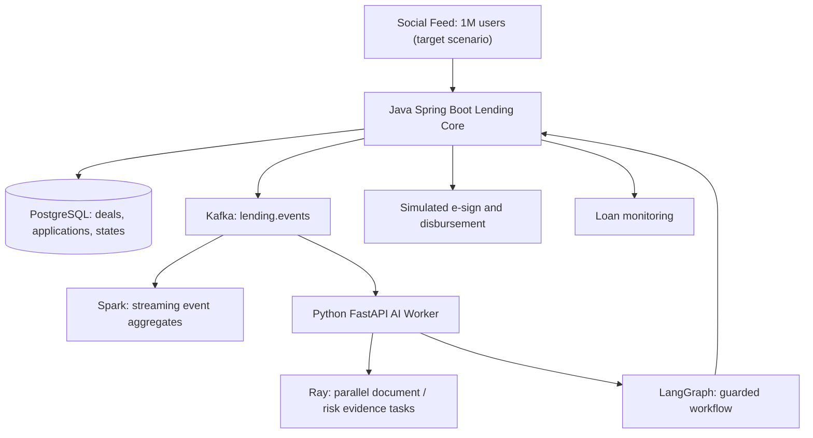

# VietPay Social P2P Lending AI MVP

**Simulation only.** A social-feed lending journey: **Post → Apply → Verify → Risk Analysis → Contract Draft → E-Sign Simulation → Disbursement Simulation → Monitoring**. No real money, binding contracts, credit scoring, personal identity checks or bank connection. Not an approved Vietnamese P2P lending sandbox service.

## Architecture



The workflow is **not** an autonomous credit approval system. Ray provides mock analytical signals, not credit decisions. LangGraph performs controlled workflow routing and outputs a review recommendation. A separate deterministic Lending Core enforces transitions and human review before simulated disbursement.

## Run

Docker Desktop / Docker Compose required.

```bash
docker compose up --build -d
curl http://localhost:8080/deals
curl -X POST http://localhost:8080/deals -H "Content-Type: application/json" -d '{"title":"Demo lending post","amount":2000000}'
curl -X POST http://localhost:8080/applications -H "Content-Type: application/json" -d '{"dealId":1,"borrowerAlias":"demo-user"}'
curl -X POST http://localhost:8080/applications/1/verify
curl -X POST http://localhost:8080/applications/1/analyze
curl -X POST http://localhost:8080/applications/1/approve
curl -X POST http://localhost:8080/applications/1/sign
curl -X POST http://localhost:8080/applications/1/disburse
curl http://localhost:8080/applications/1
```

`approve` simulates a **manual reviewer** and requires a request header `X-Demo-Reviewer: approved`. The service refuses automatic approval and prevents disbursement before signing.

AI worker health: `http://localhost:8001/health`. Spark prints aggregate event counts to logs: `docker compose logs -f spark`.

## Limitations

- 1 million users and 300,000 applications/day are **capacity targets, not tested throughput**.
- No actual eKYC, credit bureau, consent management, identity documents, digital signatures, legal contract, bank transfer, loan servicing or regulatory approval.
- Event publishing in this educational example is best effort; production needs transactional outbox, idempotent consumers, retry/dead-letter strategy, authorization, audit trail, encrypted personal data, and independent risk/compliance controls.
- Spark runs in local mode and Ray uses local workers. Neither demonstrates a production distributed cluster.
- Risk score is illustrative and must **never** be used for lending eligibility or automated financial decisions.
