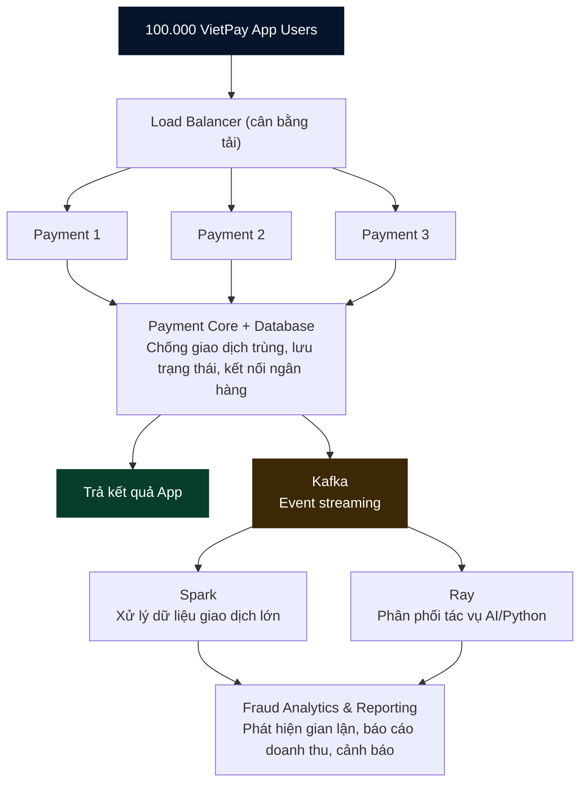

# VietPay Payment Streaming MVP (simulation)

**Portfolio demo only.** No real money movement, bank integration, or real VietPay data. This project does **not** demonstrate 100,000 concurrent users in production.

## Architecture flow (as shown in the design)



> This diagram reproduces the requested **conceptual architecture**. The MVP's implemented analytics path is sequential: Kafka payment.events → Spark → Kafka payment.features → Ray → Kafka payment.risk. Spark and Ray are not independent consumers of the same payment.events topic in this demo. The payment gateway/bank connection and 100,000 concurrent users are not implemented.

## Implementation architecture

```text
Client -> FastAPI Payment Simulator -> SQLite (idempotent transaction + outbox)
                                   -> Outbox Publisher -> Kafka payment.events
                                                       -> Spark Structured Streaming -> Kafka payment.features
                                                                                      -> Ray risk workers -> Kafka payment.risk
```

Payment response does not wait for Spark or Ray. Kafka decouples analytics from payment. The outbox is persisted in the same SQLite transaction as the simulated payment record; publisher retries unacknowledged events. Spark checkpoints its stream and writes a features topic; Ray runs parallel Python risk scoring tasks (demonstration heuristic, **not** a production fraud model).

## Run locally

Requires Docker Desktop with Docker Compose and sufficient memory (recommend >= 8 GB available).

```bash
docker compose up --build -d
curl -X POST http://localhost:8000/payments -H 'Content-Type: application/json' -H 'Idempotency-Key: demo-001' -d '{"user_id":"user-1","merchant_id":"shop-1","amount":125000}'
curl http://localhost:8000/payments/demo-001
docker compose logs -f api spark ray
```

Re-send the POST with the same idempotency key and identical payload: it returns the original transaction. Reuse the key with a different payload: HTTP 409.

## Load generation (simulation only)

```bash
python scripts/load_test.py --count 1000 --concurrency 25
```

Requires `pip install httpx` on the host. Raise load carefully; 100k *users* is not equivalent to 100k transactions per second.

## Limitations and next steps

- SQLite and one API instance are intentionally demo-grade. Production requires a transactional database, connection pooling, replicas, secure API gateway, bank/PSP integration and settlement reconciliation.
- The outbox publisher is at-least-once; consumers must deduplicate by event_id. Spark and Ray here are analytics only, not authorization.
- The Ray risk score is a deterministic illustrative heuristic; never use it to block real transactions.
- No authentication, encryption at rest, PII controls, PCI DSS assessment, observability/SLOs, production load test or real funds.
- For scale testing use distributed load generators, real latency/error metrics, Kafka partition planning, backpressure monitoring, and failure injection.
