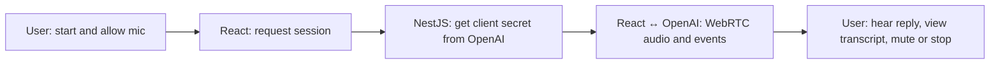

# Voice AI MVP

React + TypeScript frontend, NestJS backend, OpenAI Realtime API over WebRTC.

## Conversation flow

NestJS uses `OPENAI_API_KEY` only for session setup. Live audio and events travel directly between the browser and OpenAI.

## Requirements
- Node.js 20+
- OpenAI API key with Realtime API access

## Run locally
1. `cd voice-ai-mvp/backend`
2. Copy `.env.example` to `.env` and set `OPENAI_API_KEY`.
3. `npm install && npm run dev`
4. In another terminal: `cd voice-ai-mvp/frontend`
5. `npm install && npm run dev`
6. Open http://localhost:5173

## Features
- Start/stop voice conversation, mute/unmute
- WebRTC browser-to-OpenAI streaming
- Server-side session credentials; API key stays in backend
- Server VAD turn detection and interruption
- Live text transcripts (subject to Realtime event availability)

## Status
Prototype code, not yet end-to-end tested with a real API key or browser microphone.
Do not commit `.env` or API keys.
